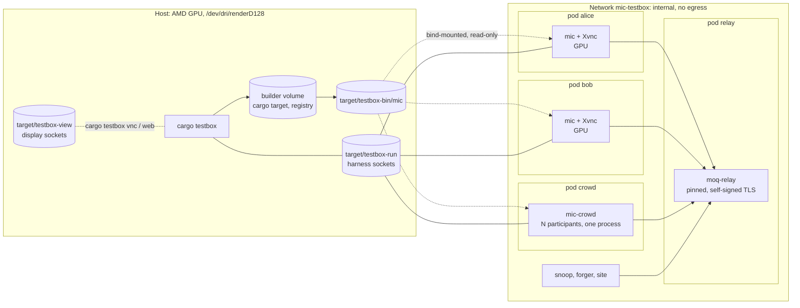

# Plan

How `mic` gets from an empty repository to the v1 conferencing app, commit by commit. The design
and its decisions (D1–D26) are in [docs/moq-iroh-research.md](docs/moq-iroh-research.md); this
file only puts them in an order.

The test box comes first, modelled on beep's (`../beep/testbox`). Every feature after that lands
together with the box phase that checks it.

## How commits are cut

- **Every commit builds and passes** `cargo fmt --check`, `cargo clippy --all-targets -D warnings`
  and `cargo test`. Once a box phase exists, `cargo testbox run <phase>` passes too.
- **One concern per commit.** A refactor that makes room for a feature is its own commit, before
  the feature.
- **A feature and its check go in the same commit**, or the check directly after it on the same
  branch. A feature never goes in without a check.
- **Docs are updated in the commit that changes the behavior** (README, `testbox/README.md`, the
  research doc's decision table).
- **Subjects** use the form `area: what is now true`, as in beep (`testbox: a screenshot waits
  for the display's pixels`). The body says why.
- **One branch per milestone**, merged into `main` as a PR. The milestone's last commit leaves
  `cargo testbox run` green.
- **Pins:** every upstream (crates, images, git dependencies) is pinned, as in beep. A pin bump is
  its own commit, with the phases rerun.

## The test box

A Podman box on an internal network with no egress: a self-hosted `moq-relay`, `mic` clients with
Xvnc displays, and headless participants to fill large rooms. moq.pro can't be reached from an
internal network, so the box uses a pinned `moq-relay`. The two speak the same protocol (§1.8).

Two goals shape it beyond beep's: **the clients use the host's GPU**, and **a change to `mic` is
in a running conference within seconds**, with dozens of participants.

**What carries over from beep, nearly as is:**

- `xtask` as `cargo testbox` (`up`, `down [--wipe]`, `test <phase>`, `run [--rounds n]`, `logs`,
  `vnc`, `web`), `pins.rs`, and every upstream pinned by digest or revision.
- `with-display` (Xvnc on a Unix socket), `vnc/`, `viewer/`, `web/` and `shot/` for watching and
  screenshots.
- Records in `target/testbox-record/<phase>/`; checks that print `check <what>: passed`; and a
  last check in every phase that no client crashed.
- An agent harness crate, `mic-harness`: JSON lines over a Unix socket (`Snapshot`, `Subscribe`,
  `Act`, `Screenshot`), served by the app when it is built with the `harness` feature.

### The host's GPU in the box

This machine has an AMD Radeon 8060S (Strix Halo). `vainfo` lists VA-API decode for VP9 and AV1,
and VA-API **encode for AV1**; Vulkan is RADV. `/dev/dri/renderD128` is mode 0666, so a rootless
container needs no extra groups.

- **Every client container gets the render node** (`/dev/dri/renderD128`, not `card1`: no
  display or mode setting, only rendering and video). With `podman kube play`, that's a
  `hostPath` volume of type `CharDevice` **(unverified that kube play passes it as a device;
  milestone 1 checks it, and falls back to `podman run --device` from the xtask)**.
- **Images carry Mesa's userspace drivers** (radeonsi for VA-API, RADV for Vulkan) at a version
  close to the host's kernel driver (Mesa 26.2 on the host). The client image's base is chosen
  for a recent Mesa, not for the oldest glibc.
- **wgpu renders on RADV**, so Slint and `moq-video`'s renderer run as on a desktop. Xvnc reads
  back the frames, which costs a copy per frame and is fine at box resolutions.
- **Video uses VA-API** where `moq-video` has a backend for it: VP9 and AV1 decode now, AV1 encode
  once the encoder is wired up (an upstream contribution, see M5).
- **Without a GPU** (CI, other hosts), `cargo testbox up --no-gpu` uses llvmpipe and lavapipe, and
  software codecs. Both paths stay green; phases that measure hardware paths are skipped, and
  say so.
- **Sharing one GPU between 40 participants:** headless participants publish pre-encoded streams
  and decode only a sample (below), so the GPU is mostly used by the few windowed clients.

### Turnaround

Where beep rebuilds its client image on every change and wipes the box between phases, `mic`'s
box aims for an edit-to-running-conference loop of seconds.

- **`mic` isn't built into an image.** A long-lived builder container (pinned, the same base as
  the client image) runs `cargo build` incrementally against persistent volumes for `target/`
  and the cargo registry. It uses mold for linking. The binary lands in
  `target/testbox-bin/` and is bind-mounted read-only into every client. A change is a rebuild
  and a client restart, never an image build.
- **Images are built once and cached.** Each image is tagged with a hash of its Containerfile,
  its build context and the pins it uses. `up` builds only images whose tag is missing, so an
  unchanged box starts without touching `podman build`. Base images are pinned by digest, and
  `apt`/cargo downloads go through cache mounts. `cargo testbox images --prune` removes stale tags.
- **Phases don't need a fresh box.** The relay holds no state worth wiping, and every check uses
  a fresh random room. Between phases, the harness `Reset` action makes a client leave its room
  and forget its state, without restarting the process. `down --wipe` is only for when something
  is wrong with the box itself.
- **Phases can run concurrently.** Since rooms are isolated by name, `run --jobs n` runs n phases
  at once on one box, each with its own clients from a pool.
- **Readiness is signalled, not waited for.** `up` returns once every harness answers `Ping` and the
  relay accepts a session. No fixed sleeps.
- **`cargo testbox dev <phase>`** is the inner loop: build, restart only the clients whose binary
  changed, run the phase, and keep the box up.

### Many participants

- **Windowed clients** (one pod each, with display and GPU) are for what needs a window: UI,
  screenshots, rendering. `up --clients 6` starts six.
- **`mic-crowd`** runs N participants in one process and one pod: the same `mic-core` sessions on
  one tokio runtime, with no UI. `up --crowd 40` starts forty. Each participant has its own
  per-room key, tone and pattern, and the harness addresses each one by name.
- **Pre-encoded media for the crowd.** Encoding 40 camera streams live would measure the box, not
  `mic`. So the crowd publishes VP9 and AV1 streams of its patterns, encoded once and cached in
  `target/testbox-media/` (keyed by the encoder pin and settings), with a live Opus tone each.
  The crowd decodes only the tracks a check asks about.
- **Budget, as a check.** `room-40` records each process's CPU, GPU and memory, and the relay's
  egress, so regressions in scale show up as numbers.

### What's new for a conferencing app

- **Synthetic media, in-process.** With the `harness` feature, the app can take its camera, mic and
  screen from generators instead of devices:
  - Each client's camera shows a pattern that encodes its name and a frame counter.
  - Each client's mic plays a tone at its own frequency.
  - The harness snapshot reports what each tile decoded (last pattern seen, frame rate, codec,
    and whether it was hardware or software) and what each remote audio stream holds (level,
    dominant frequency).

  A check can then say "bob decodes alice's camera at ≥ 25 fps, and hears 440 Hz from her and
  nothing else". No host kernel modules are needed (no v4l2loopback).
- **Real audio devices, later.** PipeWire inside the container, with a loopback from speaker to
  mic, exercises `cpal` and lets a check measure echo cancellation: alice must not hear her own
  tone come back from bob.
- **A pod per client, for per-client network shaping.** All containers in one pod share one
  network namespace, so `tc netem` there would hit everyone at once. With a pod per client,
  netem and a nftables rule (UDP blocked, for the WebSocket fallback) apply to one participant.
  The pods resolve each other through the internal network's DNS. Shaping takes `NET_ADMIN`
  inside the rootless user namespace, given only to a `netem` sidecar in the client's pod.
- **A snoop** that subscribes to every track through the relay without the room secret, to check
  that the relay and its subscribers only ever see ciphertext. A **forger** publishes under
  someone else's path. A **site** container serves the landing page and `version.json`.

## Milestones

Each numbered item below is about one commit. Box phases are in **bold**.

### M0: Repository

1. `docs: the research notes`. The research doc as it is now.
2. `Workspace and licenses`. A Cargo workspace (`crates/`), MIT and Apache-2.0 license files, a
   README stub, `.gitignore`, `rust-toolchain.toml`, `deny.toml`.
3. `ci: fmt, clippy, test on Linux, Windows and macOS`. GitHub Actions.

### M1: The empty box

4. `xtask: cargo testbox up, down and logs`. The internal network, a relay pod, `pins.rs`, and
   image tags from content hashes, so an unchanged box starts without building.
5. `testbox: moq-relay at a pin, with a self-signed certificate`. A `keys` init container makes the
   certificate. Clients trust it through a CA file (or a fingerprint, if `moq-tokio` takes one;
   unverified).
6. `testbox: the builder`. The long-lived builder container with persistent `target/` and
   registry volumes and mold; `cargo testbox build` writes `target/testbox-bin/`.
7. `testbox: displays`. `with-display`, the VNC and web viewers and `shot`, carried over from beep.
8. `testbox: the GPU in client pods`. The render node passed through, Mesa in the client image,
   and `--no-gpu` for llvmpipe and lavapipe. A tiny Slint and wgpu probe window reports its
   adapter (RADV or llvmpipe) and takes a screenshot; `vainfo` in the box lists VP9 and AV1.
9. `testbox: records, test, run and dev`. Readiness by `Ping`, the `Reset` action's place in the
   protocol, `run --jobs`. **`relay`**: a pinned moq CLI publisher and subscriber pass frames
   through the relay. This phase is the baseline for every later failure, and `dev relay` is
   timed: the target is under 10 s from an unchanged box to a result.

### M2: A client that joins a room (headless)

10. `mic-core: room ids, invites and per-room keys`. Parsing `mic://join/…` and the `https` form;
    `HKDF(device_secret, room_id)` to an Ed25519 key (D16). Unit tests.
11. `mic-core: a session with the relay`. `moq-tokio` connect, with the relay URL and CA from
    configuration (D8).
12. `mic-core: the roster`. Each participant publishes a broadcast under the room prefix with a
    `profile` JSON track (display name); the roster comes from announcements (§1.5, §5.2).
13. `mic-core: a view-model`. A toolkit-agnostic state of the room (D20) that the UI and the
    harness both read.
14. `mic-harness: the protocol, and mic --headless serving it`.
15. `testbox: mic clients`. **`roster`**: alice and bob join and see each other; bob leaves and
    alice sees him go; a restarted relay is rejoined.

### M3: The window

16. `spikes/video-tiles`. The Slint video-tile spike (§5.10): 9 wgpu textures at 30 fps, CPU and
    GPU per frame measured on a real machine. It stays in the repo, outside the workspace.
17. `mic: a Slint window over the view-model`. Join screen (name, invite) and a grid of name
    tiles.
18. `mic: the harness in the window`. Actions go through the same code paths as clicks;
    screenshots come from Slint. **`roster`** now runs with windows, and screenshots are taken.

### M4: Audio

19. `mic-media: sources and sinks behind a trait`, with the synthetic tone source and an analyzing
    sink (`harness` feature).
20. `mic-core: publish and play Opus` via `moq-audio`, at the priority and max age from §1.6.
    **`audio`**: each client hears every other's frequency and not its own.
21. `mic: mute`. **`audio`**: muted means silence on the far end, and the tile shows it.
22. `testbox: PipeWire in the clients` with a speaker-to-mic loopback. **`audio-devices`**: the
    `cpal` path end to end.
23. `mic-media: echo cancellation with sonora` (D14). **`audio-devices`**: with the loopback on,
    alice doesn't hear her own tone back.
24. `mic-media: noise suppression`. `nnnoiseless` and `sonora-ns` measured in the box against
    injected noise; the choice and the numbers go in the commit body and the research doc.

### M5: Video

25. `mic-media: a codec abstraction`, and a synthetic camera source that draws the pattern.
    Codecs are negotiated, not fixed: each participant's catalog lists the codecs it can decode,
    each encoded track declares its codec (D10), and a sender picks per track the best codec
    that every subscriber can decode. A new codec can then arrive in later releases, one track
    at a time, without breaking older clients.
26. `mic-media: VP9 decode` (the `moq-video` `vpx` feature from upstream `main`, as a git pin).
27. `mic-media: a VP9 encoder` (libvpx). **`video`**: each client decodes every other's camera, the
    pattern names the right sender, and the frame rate holds.
28. `mic: tiles render video`. `moq-video`'s renderer on Slint's wgpu device. **`video`**: pixels in
    each tile's screenshot match the sender's pattern.
29. `mic-media: AV1 decode`: VA-API where the GPU has it, dav1d or rav1d (measured) otherwise.
    `mic-media: VP9 decode` gains VA-API the same way. **`video`** runs again with one client
    encoding AV1, since every client must decode both (D10).
30. `mic-media: an AV1 encoder` for screenshare: VA-API AV1 encode where available (a backend
    for `moq-video`'s `moq-vaapi`, offered upstream), SVT-AV1 or libaom (measured) otherwise.
31. `mic: camera off`. **`video`**: the tile falls back to the name.

Upstreaming codec work to `moq-video` happens alongside, from the branches these commits come
from; the git pins move to releases as they land.

### M6: Security

32. `mic-core: moq-e2ee with the room secret from the invite` (D17). **`e2ee`**: the snoop
    receives every track but can't decrypt any; a client with the wrong secret shows that it
    can't, instead of garbage.
33. `mic-core: signed catalogs` (D18, step 1).
34. `mic-core: the sig track`. Checkpoints every 250 ms; verification fails closed after 2 s.
    **`impersonation`**: a box-only forger publishes under alice's path with another key; bob
    marks the tile and drops its media within the grace deadline.

### M7: Invites, version check, site

35. `site: the landing page and version.json`, built by GitHub Actions for GitHub Pages (D25).
36. `mic: open mic:// links`. URL-scheme registration on Linux, Windows and macOS.
37. `mic: the version check` against `version.json` (D15). **`version`**: the box's `site`
    container serves a newer version; the client says so.

### M8: Rooms

38. `mic-crowd: many participants in one process`, publishing pre-encoded streams from
    `target/testbox-media/`. `testbox: up --crowd n`.
39. `mic-core: selective subscriptions`. Subscribe only to visible tiles; the active speaker's
    priority goes up (§1.6, §5.8). **`room`**: 6 windowed clients plus the crowd.
40. `mic-core: chat, reactions and raise hand` on JSON tracks. **`room`**: each shows on every
    other client.
41. `mic: screenshare`, with a synthetic screen source in the box. **`screenshare`**.
42. `testbox: netem`. **`network`**: loss and delay keep audio intelligible (tone still dominant),
    and video recovers at the next keyframe.
43. `mic-core: the WebSocket fallback and its opt-out` (D9). **`network`**: with UDP blocked,
    clients fall back; with the opt-out, they report it.
44. **`room-40`**: 40 participants, mostly the crowd. Records CPU and the relay's egress per minute
    against the budget in §5.8. This phase isn't run in every round.

### M9: Recording

45. `mic: client-side recording to WebM` via `moq-mux`, with the indicator for everyone (D7).
    **`recording`**: every client shows the indicator; the file decodes in the box (ffprobe), with
    both codecs.

### M10: Release

46. `ci: release builds` for Windows, Linux and macOS: an AppImage and tarball, a dmg, a zip.
47. `docs: README, TESTPLAN and CHANGELOG for 0.1.0`.

### After v1

These are tracked in §8.4 and get a plan of their own when they start: moderation (creator key
first), MLS and rekeying, the identity and token server, background blur, hardware AV1 encode,
mobile, system audio, and maybe a browser client.

## Box phases at a glance

| Phase | From | What it checks |
|---|---|---|
| `relay` | M1 | Frames pass through the relay with a stock moq publisher and subscriber |
| `roster` | M2 | Join, see each other, leave, rejoin after the relay restarts |
| `audio` | M4 | Each hears every other's tone, never their own; mute |
| `audio-devices` | M4 | The `cpal` path through PipeWire; echo cancellation; noise suppression |
| `video` | M5 | Each decodes every other's pattern in VP9 and AV1, on VA-API and in software; pixels in tiles; camera off |
| `e2ee` | M6 | The snoop sees only ciphertext; a wrong secret is reported |
| `impersonation` | M6 | A forged publisher is caught within 2 s |
| `version` | M7 | A newer version is reported |
| `room` | M8 | Selective subscriptions, active speaker, chat, reactions, hands |
| `screenshare` | M8 | A shared screen reaches everyone |
| `network` | M8 | Loss, delay, and the WebSocket fallback |
| `room-40` | M8 | 40 participants, mostly `mic-crowd`; CPU, GPU, memory and egress |
| `recording` | M9 | The indicator everywhere; the file decodes |

## Open points for this plan

1. **Display tooling.** Copy beep's `with-display`, viewers and `shot` into `mic`, or move them to
   a crate both projects use? Copying is faster now. A shared crate is cleaner once both are
   stable.
2. **moq crates.** crates.io releases where they have what we need, and git pins on upstream `main`
   (for `vpx`) until releases catch up (§8.3, item 9).
3. **Synthetic media.** In-process generators for every phase, with real devices only in
   `audio-devices`. The alternative, virtual devices everywhere, needs kernel modules on the
   host for video.
