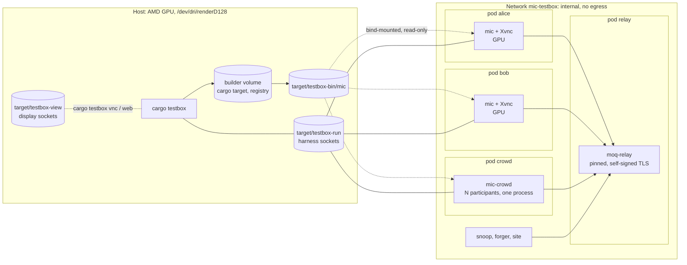

# Plan

How `mic` gets from an empty repository to the v1 conferencing app, commit by commit. The design
and its decisions (D1–D25) are in [docs/design.md](docs/design.md); this file only puts them in
an order.

The test box comes first, modelled on beep's (`../beep/testbox`). Every feature after that lands
together with the check for it: a `cargo test`, a box phase, or both.

Anything marked **⚠ unverified** is an assumption nobody has checked yet. Each one is listed in
[Unverified assumptions](#unverified-assumptions), with the commit that checks it and what
happens if it's wrong.

## How commits are cut

- **Every commit builds and passes** `cargo fmt --check`, `cargo clippy --all-targets -D warnings`
  and `cargo test`. Once a box phase exists, `cargo testbox run <phase>` passes too.
- **One concern per commit.** A refactor that makes room for a feature is its own commit, before
  the feature.
- **A feature and its check go in the same commit**, or the check directly after it on the same
  branch. A feature never goes in without a check.
- **Logic goes in the core, not a frontend.** A feature lands in `mic-core` or `mic-media` with
  its tests. The frontend part of the same commit only binds state to widgets and clicks to
  commands.
- **Docs are updated in the commit that changes the behavior** (README, `testbox/README.md`, the
  design doc's decision table).
- **Subjects** use the form `area: what is now true`, as in beep (`testbox: a screenshot waits
  for the display's pixels`). The body says why.
- **One branch per milestone**, merged into `main` as a PR. The milestone's last commit leaves
  `cargo testbox run` green.
- **Pins:** every upstream (crates, images, git dependencies) is pinned, as in beep. A pin bump is
  its own commit, with the phases rerun.

## The core and its frontends

`mic` is a core with frontends on top. Slint is the first frontend (D20). Another toolkit should
cost only its widgets: no room logic, no media, no test changes.

**Crates:**

| Crate | Holds |
|---|---|
| `mic-core` | Invites, keys, the device secret, the session, E2EE, the roster, room state and commands, reconnecting, signing, the version check, recording |
| `mic-media` | Audio and video sources and sinks (devices and synthetic), the VP9 codec, echo cancellation, noise suppression, screen capture |
| `mic-render` | Draws video tiles onto a `wgpu` device that the caller provides, or hands out CPU frames |
| `mic-harness` | The test protocol, and a server that takes a `mic-core` client. Any frontend embeds it in a few lines |
| `mic-slint` | The Slint frontend. It builds the `mic` binary |
| `mic-crowd` | Headless participants: one or many `mic-core` clients in one process, each with its own harness socket |
| `mic-testrelay` | Dev-only: a relay inside the test process, for `cargo test` |
| `xtask` | `cargo testbox` |

**Async from the start.** `mic-core` is async from its first commit, on tokio (`moq-tokio` needs
it). There's no sync API to convert later. The interface is:

- `Client::new(config, tokio::runtime::Handle)`, and `client.join(invite).await` returns a `Room`.
- `room.command(Command).await`: one enum for every action (leave, mute, camera, chat, …). Clicks
  and harness actions are both `Command`s, so they take the same path.
- `room.state()` returns a `watch::Receiver<RoomState>`. `RoomState` is plain data (`Clone`,
  `serde`, no toolkit types), and tiles are referred to by id.
- `room.events()` returns a `Stream<Item = Event>` for one-off things: a chat message, an error,
  a verification failure.
- `room.video(tile)` returns a frame stream for `mic-render`.

Frontends bring their own event loop. One built on tokio awaits the core directly. Slint's event
loop isn't tokio, so `mic-slint` runs a tokio runtime on a second thread, sends commands to it,
and moves state into the UI with `invoke_from_event_loop`.

Real-time audio callbacks (`cpal`) are threads, not tasks. They exchange samples with the async
side through lock-free ring buffers, and never await.

**Video is the hard part.** A texture can't cross toolkits, because each one creates its own
`wgpu` device and pins its own `wgpu` major version (Slint: `unstable-wgpu-30`). So `mic-render`
takes a device and queue from the caller and draws the tiles there, as `moq-video`'s renderer
allows. The workspace has one `wgpu` major, the one Slint takes. A frontend on another major uses
the CPU path (RGBA or NV12 frames) until the versions line up.

**Checks don't know the frontend.** Box phases talk only to the harness and to the display:

- Screenshots come from the Xvnc `shot`, not from the toolkit.
- The harness snapshot has a small `ui` section that the frontend fills: which screen is showing,
  and which tiles are on it. Checks compare it with the core's state.

`cargo testbox up --frontend slint` is the default. Another frontend passes the same phases once
it embeds `mic-harness` and fills that section.

## Three levels of test

- **Unit tests** in every crate.
- **Integration tests in `cargo test`**: `mic-core` clients against `mic-testrelay` in the same
  process. Joins, E2EE, the roster, reconnects, signing, and audio and video through the
  synthetic sources and analyzing sinks all run there. They run on Windows and macOS CI too,
  which the box never does.
- **Box phases** (Linux, Podman): windows, displays, the GPU, real devices, the keyring, network
  shaping, scale, and anything a stranger on the relay could see.

CI builds a release `mic` on all three platforms from M4 on (a smoke job, `mic --version`).
Each native dependency (Slint, `cpal`, libvpx, the keyring) is then built on Windows and macOS
when it arrives, not first in M10.

## The test box

A Podman box on an internal network with no egress: a self-hosted `moq-relay`, `mic` clients with
Xvnc displays, and headless participants to fill large rooms. moq.pro can't be reached from an
internal network, so the box uses a pinned `moq-relay`. The two speak the same protocol (§1.8).

Two goals shape it beyond beep's: **the clients use the host's GPU**, and **a change to `mic` is
in a running conference within seconds**, with dozens of participants.

**What carries over from beep, nearly as is:**

- `xtask` as `cargo testbox` (`up`, `down [--wipe]`, `test <phase>`, `run [--rounds n]`, `logs`,
  `vnc`, `web`), `pins.rs`, and every upstream pinned by digest or revision.
- `with-display` (Xvnc on a Unix socket), `vnc/`, `viewer/`, `web/` and `shot/` for watching and
  screenshots.
- Records in `target/testbox-record/<phase>/`; checks that print `check <what>: passed`; and a
  last check in every phase that no client crashed.
- An agent harness crate, `mic-harness`: JSON lines over a Unix socket (`Ping`, `Snapshot`,
  `Subscribe`, `Act`, `Screenshot`, `Reset`). Every frontend and `mic-crowd` embed its server
  when built with the `harness` feature.

### The host's GPU in the box

This machine has an AMD Radeon 8060S (Strix Halo). `vainfo` lists VA-API decode for VP9 and AV1,
and encode for AV1 (not VP9); Vulkan is RADV. `/dev/dri/renderD128` is mode 0666, so a rootless
container needs no extra groups.

- **Every client container gets the render node** (`/dev/dri/renderD128`, not `card1`: no
  display or mode setting, only rendering and video). With `podman kube play`, that's a
  `hostPath` volume of type `CharDevice`, which works rootless with every capability dropped
  (commit 8).
- **Images carry Mesa's userspace drivers** (radeonsi for VA-API, RADV for Vulkan) at a version
  close to the host's kernel driver (Mesa 26.2 on the host). The client image's base is chosen
  for a recent Mesa, not for the oldest glibc.
- **wgpu renders on RADV**, so Slint and `mic-render` run as on a desktop, and its frames reach
  Xvnc (commit 8). **But not with FIFO presentation:** Xvnc has no vertical blank, and 120
  frames of `vkcube` in FIFO took a minute, against a second in mailbox or immediate. Everything
  in the box presents without waiting for vblank.
- **VP9 decodes on VA-API** once `moq-video` has a VA-API VP9 decoder **⚠ unverified** (M6).
  VP9 encoding is software everywhere: AMD has no VP9 encoder.
- **Without a GPU** (CI, other hosts), `cargo testbox up --no-gpu` uses llvmpipe and lavapipe, and
  software decoding. Both paths stay green; phases that measure hardware paths are skipped, and
  say so.
- **Sharing one GPU between 40 participants:** headless participants publish pre-encoded streams
  and decode only a sample (below), so the GPU is mostly used by the few windowed clients.

### Turnaround

Where beep rebuilds its client image on every change and wipes the box between phases, `mic`'s
box aims for an edit-to-running-conference loop of seconds.

- **`mic` isn't built into an image.** A long-lived builder container (pinned, the same base as
  the client image) runs `cargo build` incrementally against persistent volumes for `target/`
  and the cargo registry. It uses mold for linking. The binaries land in
  `target/testbox-bin/` and are bind-mounted read-only into every client. A change is a rebuild
  and a client restart, never an image build.
- **Images are built once and cached.** Each image is tagged with a hash of its Containerfile,
  its build context and the pins it uses. `up` builds only images whose tag is missing, so an
  unchanged box starts without touching `podman build`. Base images are pinned by digest, and
  `apt`/cargo downloads go through cache mounts. `cargo testbox images --prune` removes stale tags.
- **Phases don't need a fresh box.** The relay holds no state worth wiping, and every check uses
  a fresh random room. Between phases, the harness `Reset` action makes a client leave its room
  and forget its state, without restarting the process. `down --wipe` is only for when something
  is wrong with the box itself.
- **But state can leak through `Reset`**, so `run --fresh` restarts every client before each
  round. It runs every few rounds and in the nightly job.
- **Phases can run concurrently.** Since rooms are isolated by name, `run --jobs n` runs n phases
  at once on one box, each with its own clients from a pool.
- **Measurements run alone.** A check that measures a rate or a budget (frame rate, CPU, egress)
  takes a box-wide lock, so concurrent phases don't skew it. Its thresholds depend on the mode:
  `--no-gpu` and software decoding have their own.
- **Readiness is signalled, not waited for.** `up` returns once every harness answers `Ping` and the
  relay accepts a session. No fixed sleeps.
- **`cargo testbox dev <phase>`** is the inner loop: build, restart only the clients whose binary
  changed, run the phase, and keep the box up.

### Many participants

- **Windowed clients** (one pod each, with display and GPU) are for what needs a window: UI,
  screenshots, rendering. `up --clients 6` starts six.
- **`mic-crowd`** runs N participants in one process and one pod: `mic-core` clients on one
  tokio runtime, with no UI. It's the headless client from M2 on; `up --crowd 40` starts forty.
  Each participant has its own device secret (in memory), per-room key, tone and pattern, and the
  harness addresses each one by name.
- **Pre-encoded media for the crowd.** Encoding 40 camera streams live would measure the box, not
  `mic`. So the crowd publishes VP9 streams of its patterns, with a live Opus tone each.
  `cargo testbox media` encodes them once **with `mic-media`'s own encoder** and caches them in
  `target/testbox-media/`, keyed by a hash of the encoder's inputs (the libvpx pin, the encoder
  settings and `mic-media`'s encoder source). The crowd decodes only the tracks a check asks
  about.
- **Budget, as a check.** `room-40` records each process's CPU, GPU and memory, and the relay's
  egress. It fails above the §5.8 budget, or on a regression beyond a margin from this host's
  recorded baseline (`target/testbox-record/baselines/`).

### What's new for a conferencing app

- **Synthetic media, in-process.** With the `harness` feature, the app can take its camera, mic and
  screen from generators instead of devices:
  - Each client's camera shows a pattern that encodes its name and a frame counter.
  - Each client's mic plays a tone at its own frequency.
  - The harness snapshot reports what each tile decoded (last pattern seen, frame rate, codec,
    and whether it was hardware or software) and what each remote audio stream holds (level,
    dominant frequency).

  A check can then say "bob decodes alice's camera at ≥ 25 fps, and hears 440 Hz from her and
  nothing else". No host kernel modules are needed (no v4l2loopback). The same generators and
  analyzers serve `cargo test`.
- **A real keyring in windowed clients.** The client image runs a Secret Service: GNOME Keyring
  in the pod's D-Bus session, as a user that isn't root (as root it aborts, failing to drop
  capabilities the container doesn't have), unlocked with a password, which makes its default
  collection (both found in commit 11). So the keyring path is what the box exercises.
  `mic-crowd` keeps its participants' secrets in memory.
- **Real audio devices, later.** PipeWire inside the container, with a loopback from speaker to
  mic, exercises `cpal` and lets a check measure echo cancellation: alice must not hear her own
  tone come back from bob **⚠ unverified**.
- **A pod per client, for per-client network shaping.** All containers in one pod share one
  network namespace, so `tc netem` there would hit everyone at once. With a pod per client,
  netem and a nftables rule (UDP blocked, for the WebSocket fallback) apply to one participant.
  The pods resolve each other through the internal network's DNS. Shaping takes `NET_ADMIN`
  inside the rootless user namespace, given only to a `netem` sidecar in the client's pod
  **⚠ unverified**.
- **A snoop** that subscribes to every track through the relay without the room secret, to check
  that the relay and its subscribers only ever see ciphertext. A **forger** publishes under
  someone else's path. A **site** container serves the landing page and `version.json`.

## Milestones

Each numbered item below is about one commit. Box phases are in **bold**.

### M0: Repository

1. `docs: the design and the ideas bin`. `docs/design.md` and `docs/ideas_bin.md` as they are now.
2. `Workspace and licenses`. A Cargo workspace (crates under `crates/`, `spikes/` excluded) with
   an empty `xtask` as its first member, since a workspace needs one, and the `cargo testbox`
   alias. MIT and Apache-2.0 license files, a README stub, `.gitignore`, `rust-toolchain.toml`,
   `deny.toml`.
3. `ci: fmt, clippy, test on Linux, Windows and macOS`. GitHub Actions.

### M1: The empty box

4. `xtask: cargo testbox up, down, logs and test`. The internal network, `pins.rs`, image tags from
   content hashes, records, and checks. **`box`**: a pod can't reach the outside, and `up` on
   an unchanged box runs no `podman build`.
5. `testbox: moq-relay at a pin, with the box's own CA`. A `keys` init container makes a CA and
   the relay's certificate; clients trust the CA (`--connect-tls-root`), as they would a real
   one. (`moq-tokio` also takes a fingerprint, `--connect-tls-fingerprint`.) **`relay`**:
   moq-tokio's `clock` example, built at the relay's pin, publishes and subscribes through the
   relay; a client without the CA is refused. This phase is the baseline for every later
   failure.
6. `testbox: the builder`. The long-lived builder container with persistent `target/` and
   registry volumes and mold; `cargo testbox build` writes `target/testbox-bin/`. **`box`**: a
   second build of an unchanged tree is a no-op, and a built binary runs in the client image.
7. `testbox: displays`. `with-display`, the VNC and web viewers and `shot`, carried over from beep.
   **`box`**: a display comes up and `shot` returns its pixels.
8. `testbox: the GPU in client pods`. The render node passed through, Mesa in
   the client image, and `--no-gpu` for llvmpipe and lavapipe. **`box`**: a tiny `wgpu` probe
   window reports its adapter (RADV, or llvmpipe with `--no-gpu`) and its colour shows up in a
   `shot`; `vainfo` lists VP9 decode.
9. `testbox: run, jobs and dev`. Readiness said by the box (the relay answers, each client logs
   that it's up; the harness's `Ping` from M2 on), `run --jobs`, `run --fresh`, `dev`.
   **`relay`**: `dev relay` is timed, and the target is under 10 s from an unchanged box to a
   result (7 s here). The box-wide measurement lock comes with the first check that measures
   (M5).

### M2: A headless client: async, encrypted, reconnecting

10. `mic-core: room ids, invites and per-room keys`. Parsing `mic://join/…` and the `https` form;
    `HKDF(device_secret, room_id)` to an Ed25519 key (D16), with the device secret passed in.
    Unit tests.
11. `mic-core: the device secret in the system keyring`. 32 bytes from the OS's random
    generator on first start, stored through `keyring-core` (Secret Service over zbus, Keychain,
    Credential Manager) and read on every later one; a store trait with an in-memory
    implementation for tests and the crowd. Tested against GNOME Keyring in a container; CI
    exercises the keyring on Windows, macOS and Linux **⚠ unverified until CI runs**.
12. `mic-testrelay: a relay in the test process`, for `cargo test`: `moq-relay` embedded, at the
    box's pin, with one TLS identity for its life, so a restart comes back on the same port with
    the same certificate. Its first test publishes and subscribes a track through it, before and
    after a restart. A test holds mic's moq crates to the box relay's versions.
13. `mic-core: an async client and session`. `Client::new(config, handle)` and
    `join(invite).await`; `moq-tokio` connect with the relay URL and CA from configuration (D8).
    Tests: join and leave against `mic-testrelay`.
14. `mic-core: moq-e2ee on every track` (D17). The track layer every later commit publishes and
    subscribes through: catalogs, `profile`, and every track to come. There's no API for a
    track in the clear **⚠ unverified** that `moq-e2ee` wraps the hang catalog like any other
    track. Tests: a subscriber without the secret gets only ciphertext; a wrong secret is an
    error, not garbage.
15. `mic-core: the roster`. Each participant publishes a broadcast under the room prefix with an
    encrypted `profile` JSON track (display name); the roster comes from announcements (§1.5,
    §5.2). Tests: two clients see each other arrive and leave.
16. `mic-core: room state, commands and events`. `RoomState` behind `watch`, `Event` as a stream,
    and `Command` with `Leave` as its first variant. Tests drive two clients by commands only.
17. `mic-core: reconnecting`. When the session drops, the client reconnects with backoff,
    announces its broadcast again and resubscribes; `RoomState` shows `Reconnecting` meanwhile.
    It sits here because it needs the roster and the state, and before any media, so every
    track is born with it. Tests: `mic-testrelay` restarts mid-call; the roster comes back with
    no duplicates. Each media commit adds "and the media resumes" to this test.
18. `mic-harness: the protocol and its server`. `Snapshot` is `RoomState` with the `ui` section;
    `Act` is a `Command`; `Screenshot` asks the display; `Reset` leaves and forgets. The server
    takes a `mic-core` client. Unit tests on the protocol.
19. `mic-crowd: headless participants`, one or many per process, each with a harness socket.
    `testbox: clients`, and the snoop. **`roster`**: alice and bob join and see each other; bob
    leaves and alice sees him go; a restarted relay is rejoined. **`e2ee`**: the snoop receives
    every track and can decrypt none; a client with the wrong secret says it can't.

### M3: Signatures

20. `mic-core: signed catalogs` (D18, step 1). Tests: a tampered catalog is rejected.
21. `mic-core: the sig track`. Checkpoints every 250 ms; verification fails closed after 2 s.
    **`impersonation`**: a box-only forger publishes under alice's path with another key; bob
    marks the tile and drops its tracks within the grace deadline. M5 and M6 rerun it with media.

### M4: The window

22. `spikes/video-tiles`. The Slint video-tile spike (§5.10): 9 wgpu textures at 30 fps, CPU and
    GPU per frame measured on a real machine. It stays outside the workspace, and CI runs
    `cargo check` on it until it's deleted (M6).
23. `mic-slint: a window over the room state`. Join screen (name, invite) and a grid of name
    tiles. The core runs on a tokio runtime on a second thread; state reaches the UI through
    `invoke_from_event_loop`. It embeds `mic-harness` and fills the `ui` section. **`roster`**
    now runs with windows: the `ui` section matches the roster, the device secret comes from
    the box's keyring, and screenshots are taken.
24. `ci: a release build of mic on Linux, Windows and macOS`. The smoke job, `mic --version`.

### M5: Audio

25. `mic-media: sources and sinks behind a trait`, with the synthetic tone source and an analyzing
    sink. Ring buffers between real-time threads and async tasks. Unit tests.
26. `mic-core: publish and play Opus` via `moq-audio`, at the priority and max age from §1.6.
    `testbox: the measurement lock` arrives here, with the first check that measures.
    Tests: tones through `mic-testrelay`, and after a relay restart. **`audio`**: each client
    hears every other's frequency and not its own. **`impersonation`** reruns with audio.
27. `mic-core, mic-slint: mute`. `Command::SetMuted`, and a button. **`audio`**: muted means
    silence on the far end, and the tile shows it.
28. `testbox: PipeWire in the clients` with a speaker-to-mic loopback **⚠ unverified**.
    **`audio-devices`**: the `cpal` path end to end. The CI smoke job now builds `cpal` on
    Windows and macOS.
29. `mic-media: echo cancellation with sonora` (D14). **`audio-devices`**: with the loopback on,
    alice doesn't hear her own tone back.
30. `mic-media: noise suppression`. `nnnoiseless` and `sonora-ns` measured in the box against
    injected noise; the choice and the numbers go in the commit body and the design doc.
    **`audio-devices`** checks a minimum gain in tone-to-noise ratio, set from that measurement.

### M6: Video (VP9)

31. `mic-media: a codec abstraction`, and a synthetic camera source that draws the pattern.
    Codecs are negotiated, not fixed (D10): each participant's catalog lists the codecs it can
    decode, each encoded track declares its codec, and a sender uses the first codec in its
    preference order that every participant in the roster can decode, as Jitsi does. (The
    roster, because a MoQ publisher doesn't see its subscribers.) v1 has one codec, so the
    choice is trivial now, but a later codec arrives without breaking v1 clients. A participant
    that can decode none of a sender's codecs is told so. A `--decoders` option (harness
    feature) limits what a client claims. Unit tests on the choice.
32. `mic-media: VP9 with libvpx`, both ways: real-time encoding for camera, its screen-content
    mode for screenshare, and decoding through `moq-video`'s `vpx` feature (a git pin on
    upstream `main`). Tests: encode the pattern, decode it, read it back. The CI smoke job now
    builds libvpx on Windows and macOS **⚠ unverified**.
33. `mic-core: publish and subscribe the camera`. Tests through `mic-testrelay`, and after a
    relay restart. **`video`**: each client decodes every other's camera, the pattern names the
    right sender, and the frame rate holds; a client started with `--decoders none` shows that
    it can't decode instead of a black tile. **`impersonation`** reruns with video.
34. `mic-render: tiles on a caller's wgpu device`, and the CPU path. Tests render offscreen on
    lavapipe in Linux CI **⚠ unverified**, and compare pixels with the pattern.
35. `mic-slint: tiles render video` through `mic-render` on Slint's device. **`video`**: pixels in
    each tile of the display's `shot` match the sender's pattern, and render cost per frame with
    9 tiles is recorded, as the spike measured it.
36. `spikes: remove video-tiles`. The box now measures what it measured; its numbers move to the
    design doc.
37. `mic-media: VP9 decode on VA-API` where the GPU has it, through a VP9 decoder for
    `moq-video`'s `moq-vaapi`, offered upstream **⚠ unverified**. **`video`** runs on VA-API
    and, with `--no-gpu`, in software.
38. `mic-core, mic-slint: camera off`. **`video`**: the tile falls back to the name.

Upstreaming codec work to `moq-video` happens alongside, from the branches these commits come
from; the git pins move to releases as they land.

### M7: Invites, version check, site

39. `site: the landing page and version.json`, built by GitHub Actions for GitHub Pages (D25).
40. `mic-core, mic-slint: the version check` against `version.json` (D15). **`version`**: the
    box's `site` container serves a newer version; the client says so.
41. `mic-slint: open mic:// links`. On Linux, `mic --register` installs the desktop file and the
    scheme handler (an AppImage can't do that by itself). On Windows, it's a registry entry; on
    macOS, `Info.plist`, which works only from the bundle, so it lands with the dmg in M10.
    **`links`**: `xdg-open mic://join/…` in the box joins the room. Windows and macOS are steps in
    TESTPLAN.

### M8: Rooms

42. `testbox: pre-encoded media for the crowd`. `cargo testbox media` encodes the patterns with
    `mic-media`'s VP9 encoder and caches them in `target/testbox-media/`; `mic-crowd` publishes
    them; `up --crowd n`.
43. `mic-core: selective subscriptions`. Subscribe only to visible tiles; the active speaker's
    priority goes up (§1.6, §5.8). **`room`**: 6 windowed clients plus the crowd.
44. `mic-core, mic-slint: chat, reactions and raise hand` on JSON tracks, encrypted like every
    other. **`room`**: each shows on every other client.
45. `mic-media, mic-slint: screenshare`. Capture in `mic-media`, the picker in the frontend, VP9 in
    screen-content mode, and a synthetic screen source in the box. **`screenshare`**.
46. `testbox: netem`, in a `NET_ADMIN` sidecar **⚠ unverified**. **`network`**: loss and delay
    keep audio intelligible (tone still dominant), and video recovers at the next keyframe.
47. `mic-core: the WebSocket fallback and its opt-out` (D9), if the pinned `moq-relay` serves
    WebSocket and `moq-tokio` can turn its fallback off **⚠ unverified**. **`network`**: with
    UDP blocked, clients fall back; with the opt-out, they report it.
48. **`room-40`**: 40 participants, mostly the crowd. Records CPU, GPU, memory and the relay's
    egress per minute against the budget in §5.8 and this host's baseline. It runs alone, and not
    in every round.

### M9: Recording

49. `mic-core, mic-slint: client-side recording to WebM` via `moq-mux`, with the indicator for
    everyone (D7). **`recording`**: every client shows the indicator; the file decodes in the box
    (ffprobe).

### M10: Release

50. `ci: release packages` for Windows, Linux and macOS: an AppImage and tarball, a dmg, a zip.
51. `docs: README, TESTPLAN and CHANGELOG for 0.1.0`.

### After v1

These are tracked in §8.2 and get a plan of their own when they start:

- **AV1**, as the first codec to arrive through negotiation: screenshare first, where its screen
  tools gain most. VA-API AV1 encode is already on this host, so the box can test the hardware
  path. While a v1 client is in a room, AV1 senders there fall back to VP9.
- Moderation (creator key first), MLS and rekeying, the identity and token server.
- Background blur, adaptive codec switching under CPU pressure, mobile, system audio.
- Moving the device secret to a new device.

## Box phases at a glance

| Phase | From | What it checks |
|---|---|---|
| `box` | M1 | No egress; cached images; the builder; displays; the GPU |
| `relay` | M1 | Frames pass through the relay with a stock moq publisher and subscriber; `dev` turnaround |
| `roster` | M2 | Join, see each other, leave, rejoin after the relay restarts; with windows and the keyring from M4 |
| `e2ee` | M2 | The snoop sees only ciphertext, on every track; a wrong secret is reported |
| `impersonation` | M3 | A forged publisher is caught within 2 s; with media from M5 and M6 |
| `audio` | M5 | Each hears every other's tone, never their own; mute |
| `audio-devices` | M5 | The `cpal` path through PipeWire; echo cancellation; noise suppression |
| `video` | M6 | Each decodes every other's pattern, on VA-API and in software; no decodable codec is reported; pixels in tiles; camera off |
| `version` | M7 | A newer version is reported |
| `links` | M7 | A `mic://` link joins the room |
| `room` | M8 | Selective subscriptions, active speaker, chat, reactions, hands |
| `screenshare` | M8 | A shared screen reaches everyone |
| `network` | M8 | Loss, delay, and the WebSocket fallback |
| `room-40` | M8 | 40 participants, mostly `mic-crowd`; CPU, GPU, memory and egress |
| `recording` | M9 | The indicator everywhere; the file decodes |

## Unverified assumptions

Each is checked by the commit named, which settles it in its body and in the design doc.

| Assumption | Checked in | If it's wrong |
|---|---|---|
| Slint's wgpu backend can present in mailbox or immediate mode, not only FIFO, which stalls on Xvnc | 23 | Slint's software renderer in the box, or a present mode set through `WGPUConfiguration::Manual` |
| The keyring works on GitHub's Windows and macOS runners, and GNOME Keyring on its Linux one (it does in a container here) | 11 (CI) | The keyring test is skipped in CI where it can't run, and the box's clients cover Linux |
| `moq-e2ee` encrypts the hang catalog like any other track | 14 | `mic` encrypts the catalog's payload itself, with a key derived the same way |
| PipeWire runs in a rootless container with a speaker-to-mic loopback | 28 | A virtual sink and source in the `cpal` test path only, without PipeWire |
| libvpx builds and links on the Windows and macOS CI runners | 32 | A vendored static build through the binding's build script |
| lavapipe renders offscreen in GitHub's Linux runners | 34 | `mic-render`'s pixel tests run in the box only |
| `moq-vaapi` can take a VP9 decoder | 37 | VP9 decodes in software everywhere; the box's GPU is used for rendering |
| A `NET_ADMIN` sidecar can shape traffic for one pod in rootless Podman | 46 | Shaping on the relay's side, per client address |
| The pinned `moq-relay` serves WebSocket, and `moq-tokio`'s fallback can be turned off | 47 | The fallback waits for upstream; D9's opt-out is reported as missing |
| 40 participants in one `mic-crowd` process stay within the §5.8 budget | 48 | The crowd is split over several pods |

## Open points for this plan

1. **Display tooling.** Copied from beep into `testbox/view/` (commit 7), relicensed MIT OR
   Apache-2.0 from beep's AGPL-3.0-only. A crate both projects share is cleaner once both are
   stable.
2. **moq crates.** crates.io releases where they have what we need, and git pins on upstream `main`
   (for `vpx`) until releases catch up (design §8.1, item 7).
3. **Synthetic media.** In-process generators for every phase, with real devices only in
   `audio-devices`. The alternative, virtual devices everywhere, needs kernel modules on the
   host for video.
4. **No keyring.** What `mic` does on a machine without one: refuse to start, or offer to keep
   the device secret in a file (design §8.1, item 4).
5. **`wgpu` versions.** What another frontend on a different `wgpu` major costs on the CPU path.
