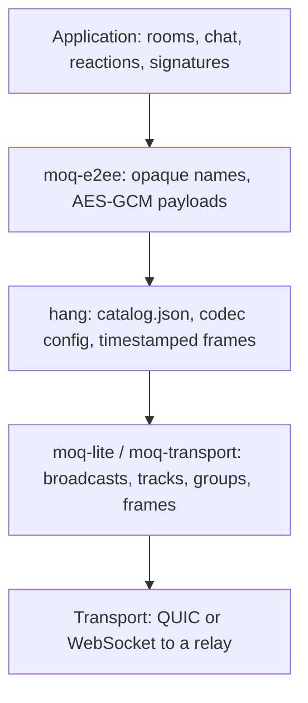
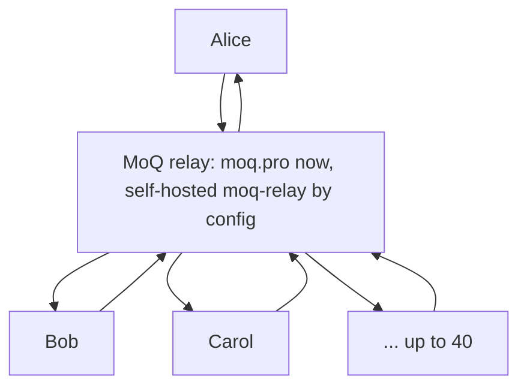
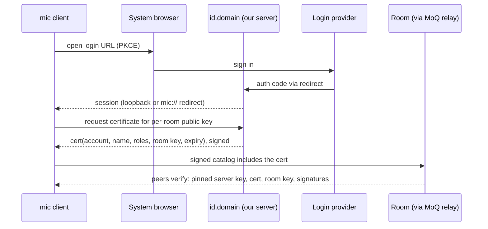

# Design

The design of `mic`: a video-conferencing app on Media over QUIC, for Windows, Linux and macOS.
This file holds the decisions and what they rest on. [PLAN.md](../PLAN.md) puts the work in
order. What was considered and dropped, and how the decisions came about, is in
[ideas_bin.md](ideas_bin.md).

Markers used in this document:

- **(inference)** means it's our conclusion; no source says it directly.
- **(unverified)** means it comes from general knowledge and wasn't checked against a source.
  Confirm it before relying on it. PLAN.md lists where each one gets checked.
- **D1–D25** are the decisions in §0. Their numbers are stable; retired numbers (D19, D26) are
  in the ideas bin.

Sources are listed at the end.

---

## 0. Decisions

| # | Topic | Decision |
|---|---|---|
| D1 | Web | No web client in v1. |
| D2 | Mobile | Not now. Keep the path open. |
| D3 | Room size | Typically 2–5 people, up to 30–40. |
| D4 | Watching together | The host streams a screen or window. Synchronized playback may come later. |
| D5 | Accounts, moderation | **Anonymous rooms:** anyone with the invite joins and enters a display name. **Later, moderation like Jitsi:** people with a "login" moderate ephemeral rooms (lobby, kick, mute). The identity system is open (§5.15). |
| D6 | Privacy | Servers must not see media; E2EE guarantees that (D17). The relay sees metadata (IP addresses, timing, sizes); **that's accepted** (§5.1). |
| D7 | Features | Chat, reactions, and client-side recording. While someone records, **everyone sees an indicator, like Microsoft Teams**; there's no consent prompt. No in-app media playback. **Background blur** comes first among later features. |
| D8 | Hosting | Self-hosted or managed, chosen by configuration. **moq.pro for now**, with a public prefix until a token service exists (§5.11). Free allowance assumed to be 400 GB/month, which is enough for now. |
| D9 | Fallbacks | On by default; users can opt out. With relay only (D22), that's QUIC with a WebSocket fallback (§5.9). |
| D10 | Video codec | **VP9 for every track in v1** (libvpx, with its screen-content mode for screenshare). **Codecs are negotiated per track:** each catalog lists the codecs its participant can decode, and a sender uses the first codec in its preference order that every participant can decode, as Jitsi does. So AV1 can arrive in a later release without breaking v1 clients (§5.4). Codec work goes **upstream** into `moq-video` where possible. |
| D11 | H.264 | Not used. |
| D12 | System audio | Out of scope for now. Screenshare carries no audio. |
| D13 | Shared media | None. |
| D14 | Audio processing | The app does it; no C++ libwebrtc. Echo cancellation: **`sonora`**. Noise suppression: **`nnnoiseless` or `sonora-ns`**, chosen by testing during implementation. |
| D15 | Updates | No auto-update. An "am I on the latest version?" check against **semver** releases (§5.12). |
| D16 | Identity | **One identity per room**, derived from a device secret: `HKDF(device_secret, room_id)` gives a plain Ed25519 key (`ed25519-dalek`). The device secret is 32 random bytes from the OS, made on first start and kept in the **system keyring** (§5.2). Display names are self-asserted. |
| D17 | Encryption | **`moq-e2ee` on every track**: media, catalogs, profiles, chat, reactions, signatures. Nothing `mic` publishes is in the clear. v1 uses a static room secret carried in the invite. **MLS is a tracked follow-up** (§5.3.3). |
| D18 | Impersonation | Each participant **signs with its per-room key**: a catalog bound to the epoch, plus **checkpoint signatures every 250 ms on a separate `sig` track**. Verification fails closed, with a **2 s grace deadline** (§5.3.2). |
| D20 | UI | **Slint**, over a toolkit-agnostic core (§5.10). |
| D21 | Product reference | **Jitsi Meet (meet.jit.si):** the service should feel similar (§5.14). |
| D22 | Topology | **Relay only; no P2P.** Every room, of any size, goes through a MoQ relay (moq.pro for now). |
| D23 | Platforms | First release: **Windows, Linux, macOS**. Build cross-platform and see; no dedicated Mac experiment. |
| D24 | License | Open source, **MIT + Apache-2.0**. |
| D25 | Invites, web presence | **A domain hosted on GitHub Pages, generated by GitHub Actions.** It serves an invite **landing page** (an `https` link that opens `mic://`, or offers downloads), the version feed, and published keys. No server code runs there (§5.14). |

### 0.1 What follows from the decisions

- **One transport.** Every client connects out to the MoQ relay over QUIC,
  with a WebSocket fallback.
  - No hole punching, mesh or mode switching.
  - Room size only changes what each client subscribes to (§5.8).
- **Native desktop: Windows, Linux, macOS** (D23). The Slint UI renders
  `moq-video`'s wgpu 30 textures directly. Slint also runs on Android and
  iOS, which keeps D2 open.
- **Codecs.**
  - Video: VP9 via libvpx, both ways (upstream `vpx` feature for decoding).
  - Audio: Opus.
  - E2EE rules out transcoding and there's no auto-update, so old clients
    stay in rooms. Negotiation (D10) keeps that from freezing the codec set:
    a newer codec is only sent to rooms where everyone can decode it.
- **Audio chain:** sonora echo cancellation, then noise suppression
  (`nnnoiseless` or `sonora-ns`), then Opus.
- **Identity.** The per-room key signs catalogs and checkpoints directly; no
  session-key certificate is needed (§5.3.2). Display names are
  self-asserted, and name collisions are shown with fingerprint words
  (§5.3.4).
- **Recording** happens on the client, written as WebM via `moq-mux`, with an
  indicator for everyone.
- **Infrastructure** (all configurable):
  - moq.pro (public prefix now, token service later).
  - **A static site on our domain** (GitHub Pages, built by GitHub Actions):
    invite landing page, `version.json`, published keys (§5.11).
  - Later, **one small server** for identity and relay tokens (§5.15). It
    can't run on GitHub Pages.
  - No STUN/TURN, signaling server or media server.
- **Slint licensing:** use Slint's royalty-free license and show the
  `AboutSlint` widget in an About dialog. Under the GPL-3.0 option, distributed
  binaries would be GPL, which defeats MIT + Apache (D24)
  **(inference; not legal advice)**.

## In short

- **Media over QUIC (MoQ)** is a live-media publish/subscribe protocol built on
  QUIC.
  - The IETF version is `draft-ietf-moq-transport-22` (Oct 2026). The working
    group plans to send it to the IESG in Dec 2026.
  - The most usable implementation is [moq.dev](https://moq.dev)
    (`moq-dev/moq`, Rust + TypeScript). It ships **moq-lite**, a
    forward-compatible subset of the IETF draft, and **hang**, a media layer
    (catalog plus timestamped frames).
  - `moq-room` provides a MoQ-native conferencing roster.
- **`mic`** is a native client on moq.dev's Rust crates. Every participant
  publishes encrypted, signed tracks to a MoQ relay (moq.pro, or a self-hosted
  `moq-relay`) and subscribes to the tracks it wants to see and hear.

---

## 1. Media over QUIC (MoQ)

### 1.1 Why QUIC for media

From the moq.dev transport docs:

- **No head-of-line blocking across streams.** RTMP, HLS, and SRT ride a single
  byte stream, so during congestion old frames block new ones. In QUIC, each
  stream has its own ordering and flow control.
- **Partial reliability.** A stream can be reset mid-flight. MoQ resets a group
  once it's too old to matter.
- **Prioritization.** The sender picks which stream goes next, so audio and new
  groups starve old video instead of the reverse.
- **Encryption, congestion control, and connection migration** come for free.

MoQ is **pull-based**: nothing is sent until someone subscribes. Relays merge
duplicate subscriptions, and publishers that watch demand can skip encoding
entirely.

### 1.2 Standards landscape

| Spec | Who | Status / notes |
|---|---|---|
| `draft-ietf-moq-transport` (MOQT) | IETF MoQ WG (Cisco, Google, Meta editors) | Draft **-22**, 2026-10-01. Milestone: request publication Dec 2026. |
| `draft-ietf-moq-msf` | IETF | MoQ Streaming Format (a catalog). Expected to converge with the hang catalog. |
| `draft-ietf-moq-loc` | IETF | Low Overhead Container. |
| `draft-ietf-moq-secure-objects` | IETF | End-to-end object encryption (SFrame lineage). |
| `draft-lcurley-moq-lite` | moq.dev | The pub/sub subset moq.dev speaks. Works against moq-transport relays. |
| `draft-lcurley-moq-hang` | moq.dev | Media layer: "a real-time conferencing protocol built on top of moq-lite". |
| `draft-lcurley-moq-e2ee` | moq.dev | The `moq-e2ee-00` end-to-end encryption profile (D17). |

moq.dev's stacks negotiate **moq-lite 01–06** and **moq-transport drafts
14–22** by ALPN.

### 1.3 Layering



**Rule 1** from the moq README: the relay must not know anything about your
application, codecs, or tracks. Everything could be end-to-end encrypted and
the relay wouldn't care. That's what makes D6/D17 work through moq.pro.

### 1.4 Data model

| moq-lite | Meaning | moq-transport name |
|---|---|---|
| Session | One connection, publishing and subscribing at once | Session |
| Origin | The set of broadcasts visible to a session, scoped by path | (none) |
| **Broadcast** | Named, discoverable collection of tracks from one publisher | Namespace |
| **Track** | Live sequence of groups | Track |
| **Group** | Frames delivered reliably and in order on **one QUIC stream** | Group |
| **Frame** | A sized chunk of bytes | Object |
| Datagram | One unreliable frame (<~1200 bytes) as a QUIC datagram | Datagram |

How media maps onto this:

- **Video:** a group is a GoP that starts at a keyframe.
- **Audio:** a group holds about a second of samples.
- **Data:** a group is whatever unit can be skipped as a whole.

### 1.5 Discovery, which is how a conference roster works

A session asks for **announcements matching a path prefix**. The peer replies
with what exists now, then streams changes. Path patterns support `*`, `**`,
and so on. Segments starting with `.` are hidden from discovery.

### 1.6 Subscription knobs: latency is per subscriber

| Knob | Effect |
|---|---|
| **Priority** (0–255) | In moq-lite, **higher = served first**. In IETF moq-transport, **lower = higher priority**. |
| **Order** | Newest-group-first for live; oldest-first for catch-up. |
| **Max age** | How old a non-latest group may get before it's skipped. Measured on the media timeline. |

The moq-lite conference example uses:

- audio: priority 100, ascending, max age 500 ms;
- video: priority 50, descending, max age 2 s.

The use-cases draft adds **active-speaker prioritization**: raise the current
speaker's priority, and keep audio above all video.

### 1.7 hang: the media layer

- Broadcast names end in `.hang`.
- The **`catalog.json`** track lists renditions, each extending the WebCodecs
  decoder config.
  - "Every WebCodecs codec is fair game; H.264, H.265, VP8, VP9, AV1, AAC, and
    Opus are what the tools produce today."
  - So **VP9 is representable in the catalog** (e.g. a `vp09.…` codec string).
    The gap is in the native codec backends (§5.4).
- **Data tracks** (`json` and `binary` sections) carry chat, reactions, and
  similar, in `snapshot` or `stream` mode.
- **Containers:**
  - `legacy`: a varint µs timestamp plus payload. The default.
  - `cmaf`.
  - `loc`.
- hang is a convention, not a requirement. You can publish raw tracks.

### 1.8 Relays, clustering, auth, moq.pro

**`moq-relay` (self-hosted):**

- MIT/Apache.
- Clustering, LAN mesh via mDNS, BBRv3 congestion control.
- A public deployment needs:
  - a stable hostname;
  - UDP (QUIC) open, plus TCP if HTTPS or the WebSocket fallback is enabled;
  - a trusted TLS certificate;
  - an auth policy;
  - Linux UDP buffers raised to 8 MiB.

**Auth (relay and moq.pro alike):**

- JWTs with `root`, `publish` patterns, `subscribe` patterns, and `exp`.
- Or static public grants on a prefix.
- Or an auth server.

**moq.pro (managed; D8).**

The site is a client-side JavaScript app that my fetch tool can't render. The
details below come from its JS bundle (downloaded 2026-10-24) and the
announcement post "Open For Business" (2026-08-17). Confirm them in the
dashboard.

- Run by the moq.dev author (Kixel, Corp.). A global edge CDN: clients connect
  to the nearest edge, and duplicate subscriptions merge inside the CDN.
- Client URL: `https://cdn.moq.pro/...`. Compatible with moq-transport drafts
  14–19+.
- **Pricing (from the site code):**

  | Item | Price |
  |---|---|
  | Live delivery (outbound) | $0.04/GB |
  | Inbound | Free |
  | Recording playback | $0.02/GB |
  | Recording | $0.01/GB |
  | Storage | $0.015/GB-month |
  | Voice AI | Separate rate |

- **Free allowance:** the site code says **400 GB** of delivery per month. The
  moq.dev homepage says **500 GB**. Check which is current.
- **Auth model:**
  - Projects hold signing keys, symmetric or asymmetric JWK. The private key of
    an asymmetric key isn't stored server-side.
  - Scoped tokens (root, publish and subscribe patterns, exp) are minted from
    those keys; a token asking for more than its key allows is refused.
  - A per-project **"Public access"** setting allows anonymous publish and
    subscribe on prefixes.
- **Other features:** RTMP/WebRTC/SRT gateways, HLS recordings to "our bucket
  or yours", real-time stats, Cloudflare sync, voice AI.
- Native clients dial `https://cdn.moq.pro` via `moq-tokio`, over QUIC or
  WebSocket.
- Its terms say live media "passes through our relays and may be buffered or
  cached for delivery". Under D17, that's ciphertext.

### 1.9 End-to-end encryption (always on: D17)

- **`moq-e2ee-00`** (moq.dev draft, `moq-e2ee` crate):
  - **Key:** a 32-byte broadcast secret shared **out of band**.
  - **Derivation:** HKDF-SHA-256 derives opaque broadcast paths, opaque track
    names, and per-track AES-128-GCM keys.
  - **Nonces:** a per-publisher-instance *epoch* keeps them unique.
- **What relays still see:** sizes, timing, group/frame structure, opaque
  paths, epochs, and connection metadata.
- **Limits:**
  - No key distribution, no padding, no rekeying inside an epoch.
  - **No sender authentication** among holders of the secret. The spec:
    "Sender authenticity against another endpoint that also holds the secret
    is not a goal". That gap is what D18 fills (§5.3.2).
  - The spec says applications needing more "terminate this profile and run a
    different one". Signatures inside the encrypted payload stay compatible
    **(inference)**.

### 1.10 Libraries

Rust crates (all on crates.io):

| Crate | Role |
|---|---|
| `moq-net` | Pub/sub layer. Transport-agnostic and sans-IO. Runs over noq and qmux/WebSocket. |
| `moq-tokio` | Sets up QUIC (noq), TLS and the WebSocket fallback. URL schemes: `https://`, `moql://`/`moqt://`. Also has an optional `webrtc` feature; leave it off. |
| `hang`, `moq-mux` | Catalog and containers. |
| `moq-video` | Native capture, hardware encode/decode, wgpu render. Details below. |
| `moq-audio` | Mic and speaker, Opus (DTX + per-packet voice activity), a mixing playback engine, and AEC. Dependencies include **`sonora`** (optional), `unsafe-libopus`, `cpal`, and `rubato`. No noise-suppression API is documented. |
| `moq-room` | Headless rooms: an announce-derived roster and a chat track. |
| `moq-auth`, `moq-e2ee`, `moq-json`, `moq-relay` | Auth, E2EE, JSON tracks, and the embeddable relay. |

**`moq-video` codec support.** Released v0.1.16 (docs.rs, 2026-10-23):

- **Encode:** `encode::Codec` has only `H264` and `H265`. It's
  `#[non_exhaustive]` so codecs can be added.
  - Backends: NVENC (`moq-nvenc`), VAAPI (`moq-vaapi`), VideoToolbox, Media
    Foundation, MediaCodec, V4L2, and optional openh264.
- **Decode:** "H.264, H.265, or AV1 … AV1 is decode-only on NVDEC. H.265 and
  AV1 are hardware-only … **Any other codec yields
  `Error::UnsupportedCodec`**".
- `openh264` is optional (and "opt-in, enabled for releases" on `main`), so
  D11 is satisfiable.

**Upstream `main`** (checked 2026-10-24):

- **VP8/VP9 software decode via libvpx** behind the opt-in `vpx` feature, using
  `libvpx-native-sys` 5.0.17 (PR #4095, merged 2026-09-25, on `main` since
  2026-10-06).
  - It decodes **8-bit 4:2:0 only** (VP8, VP9 profile 0).
  - libvpx comes from the build host (`VPX_STATIC=1` links it statically).
  - It's **not in the 0.1.16 crate**.
- **No VP9 or AV1 encode.** Upstream backlog items ("quests"):
  - NVENC AV1 encode (`quest/m3/nvenc-av1.md`) waits on an Ada GPU for CI.
  - Software AV1 decode via dav1d is under review in
    `quest/m3/video-codec-coverage.md`, which says: "No consumer has asked
    for a missing codec".
  - `mic` could be that consumer.
- **`moq-mux`** imports VP8/VP9/AV1. Its MKV exporter writes `V_VP8`/`V_VP9`/
  `V_AV1` + `A_OPUS` and picks DocType `webm` when every track is
  WebM-compatible.
- wgpu is `^30`.
- `render::Renderer::new(&device, &queue, …)` takes an *external* wgpu device
  and queue. That's what lets a UI toolkit share its device (§5.10).


## 5. Design for `mic`, with the decisions applied

### 5.1 Topology: relay only (D22)



**What relay only buys:**

- **One code path** for every room size. Same transport, roster and
  signatures; no mode switching or call migration.
- **One upload per rendition**, whatever the room size. A mesh would upload a
  copy to every peer.
- **Outbound connections only, to a public server.** No NAT traversal. The
  WebSocket fallback over TCP 443 gets through restrictive firewalls.

**What it costs (inference):**

- **Egress on every call**, 1:1 included (budget in §5.8).
- **One extra hop of latency** compared with direct P2P. moq.pro connects
  clients to a nearby edge, which limits it.
- **Metadata at the relay:** IP addresses, timing, sizes, and which opaque
  broadcasts belong to one room.
- **Availability:** if the relay is down, nobody can call. A self-hosted
  `moq-relay` is the configuration fallback.
- **Sender authenticity rests entirely on signatures** (D18).

| Aspect | Design |
|---|---|
| Transport | `moq-tokio` to `https://cdn.moq.pro`: QUIC, racing a WebSocket fallback |
| Encryption | `moq-e2ee` (D17); the relay sees only ciphertext |
| Sender authenticity | Signatures (D18, §5.3.2) |
| Roster | Announcements under a room-level opaque prefix, plus signed catalogs (§5.2) |
| Infrastructure | moq.pro; later a token service (§5.11) |

### 5.2 Identity, roster, and broadcast layout

**Identity: one per room (D16).**

- Each room gets its own plain Ed25519 key (`ed25519-dalek`).
- **Derivation:**
  - `room_key = HKDF(device_secret, "mic/v1/room-identity" || room_id)`.
  - A reconnect to the same room keeps the same identity, and nothing needs
    storing per room.
  - Different rooms can't be linked unless the device secret leaks.
  - A "new identity" action replaces the device secret.
- **The device secret:**
  - **Made on first start** as 32 bytes from the OS's random generator
    (`getrandom`). HKDF wants uniformly random input key material, and that's
    exactly it. No passphrase and no user input: the secret identifies a
    device, not a person, and nothing else ever needs to reproduce it.
  - **Kept in the system keyring** and nowhere else: Windows Credential
    Manager, macOS Keychain, and the Secret Service on Linux (GNOME Keyring,
    KWallet), through the `keyring` crate **(unverified: its current backends
    and their behavior when no Secret Service runs)**.
  - Losing it only means new identities in every room. There's no backup in
    v1.
  - `mic-core` reads it through a small store trait, so tests and headless
    participants can use an in-memory store.
- Display names (D5) are self-asserted. Name collisions are shown with
  fingerprint words (§5.3.4).

**Downsides of per-room identities:**

| Downside | Impact | Mitigation |
|---|---|---|
| Nobody recognizes you across rooms | No "seen before" badges (TOFU); verification codes have to be compared again in every room. A copied display name is easier to get away with. | Fingerprint words within a room (§5.3.4). Later, logins (D5). |
| Reconnects look like new people | Only if keys are random per join: roster churn, split chat and recording attribution, lost moderator status. | Solved by the derived key (above). |
| Blocks and mutes don't follow anyone | Abuse handling stays per room. A kicked person can come back under a new key if they still have the invite. | Rotate the invite or room secret after a kick (needs rekeying, §5.3.3). Keys are free in any anonymous system anyway. |
| Logins bring linkability back | A login certifying a per-room key reveals the account to the room, and the login service learns which rooms you join. | Acceptable for moderators. Anonymous credentials exist but are complex. |
| Network-level linking remains | The relay sees your IP address in every room. Per-room keys only unlink you towards other participants. | Out of scope (would need a VPN or Tor). |
| Rate limits by identity don't work | Relevant to a future token service. | Rate-limit by IP or per room. |

**Roster discovery (inference):**

- A participant's broadcast path derives from its semantic name, which
  contains its key. Others don't know that key yet, so they can't derive the
  path.
- So `mic` publishes every participant's broadcast under a **room-level opaque
  prefix**: `<room_prefix>/<opaque>/<epoch>`, with
  `room_prefix = HKDF(room_secret, "mic/v1/room-prefix" || room_id)`.
  - `moq-e2ee` allows remounting under a prefix, since the outer path isn't
    part of its derivation.
  - A room's session is rooted at the prefix by its URL's path
    (`<relay>/<room_prefix>`), as a relay roots every session: the session
    publishes under it, and hears of no other room's broadcasts. Scoping the
    session's origin instead only renames paths on the client's side; on the
    wire they're unprefixed, and every room's participants would see each
    other's broadcasts (found in commit 14).
- Clients discover participants from announcements under `room_prefix/`, then
  open their signed catalogs.
- The relay learns which broadcasts form one room, but not who is in it.

**Semantic layout (inference),** following `moq-room`'s convention:

| Semantic name | Contents |
|---|---|
| `{room}/{participant-key}/camera.hang` | Camera video, mic audio, chat, reactions, and the `sig` track |
| `{room}/{participant-key}/screen.hang` | Screen video only (D12), plus its `sig` track. Announcing it means sharing has started. |

`moq-e2ee` hashes these names into opaque segments. The relay never sees room
names or participant keys.

### 5.3 Encryption, keys, and signatures

#### 5.3.1 `moq-e2ee` everywhere (D17)

- **Every track is encrypted**, with no exceptions: media, `catalog.json`,
  `profile`, chat, reactions, participant state and `sig`. The relay sees
  only ciphertext and opaque names. In `mic-core`, there's no API to publish
  or subscribe a track in the clear. `moq-e2ee` wraps any moq track, the
  catalog included: it works per track (`Generation::produce`/`consume`), so
  `mic` writes its catalog to an encrypted track of its own.
- **How `moq-e2ee-00` keys work** (re-checked against the draft):
  - The application supplies a credential `{context, kid, secret}`.
    - Rotating the secret means a new `kid`.
    - Implementations must hold several credentials at once, which is what a
      rekey transition needs.
  - The opaque path segment is derived from `secret`, `context`, `kid` and the
    semantic broadcast name. **So a rekey moves every broadcast to a new
    opaque path.** Subscribers have to follow (make-before-break).
  - Each publisher instance mints an *epoch* (UUIDv7 recommended), which is the
    last path segment. Subscribers "select the greatest epoch".
  - Quote: **"The epoch and the path are not secret and are not
    authenticated."** §5.3.2 covers why that matters.
- **Anonymous rooms, v1 (decided, D17):**
  - The 32-byte room secret travels inside the `mic://` invite, so the invite
    is the capability to join.
  - It also derives the room-level path prefix (§5.2).
  - **Weakness: no forward secrecy against a leaked invite.** Someone who
    captured ciphertext (e.g. the relay operator, or an earlier participant)
    and later gets the invite can decrypt all of it, passively and invisibly.
  - Accepted for v1. MLS is the tracked follow-up (§5.3.3).
- **Moderated rooms (later):** a kick requires **rekeying**, i.e. a new `kid`
  that only the remaining members receive.
  - With relay only (D22), there are no pairwise connections to deliver it
    over. It has to go through the relay, encrypted to each remaining
    member's public key.
  - That needs a per-member encryption key (an X25519 key in the signed
    catalog, HPKE-style), or MLS, which does exactly this **(inference)**.

#### 5.3.2 Signing with the per-room key (D18)

**What signatures do and don't solve:**

- **The threat.** Every member holds the room secret, so any member can
  encrypt frames under any other member's semantic name. On the relay, a
  member can also announce a victim's path, or a newer epoch under the
  victim's prefix.
- A relay can't forge anything, because it doesn't hold the secret.
- Signatures bind *streams* to a participant key. They don't bind a *human*
  to one (§5.3.4).
- **This goes beyond common practice:**
  - SFrame (RFC 9605 §7.2) has "No Per-Sender Authentication". It says a
    mechanism based on digital signatures would be required to stop a
    malicious participant impersonating others.
  - Discord's DAVE says its per-sender keys "are not used for per-sender
    authentication, since any member of the group can derive the key for any
    sender".
  - Jitsi's per-participant keys have the same property (§5.14).

**Problems a naive scheme (one long-term key, one signature per group) has, and
how this one handles them:**

| # | Problem | Status |
|---|---|---|
| P1 | **One key, several protocols.** A key that signs for more than one purpose lets one signature be replayed as another. | Every `mic` signature starts with a unique, versioned domain-separation prefix. |
| P2 | **Long-term key in the hot path.** A leak allows permanent impersonation; EndpointIds can't be revoked. | **Resolved** by per-room keys: a leak affects one room. |
| P3 | **Slow detection.** Per-group signatures are checked when the group ends (~1 s). | **Resolved** by 250 ms checkpoints. |
| P4 | **Missing or stripped signatures.** | Fail closed (step 5 below). |
| P5 | **Epoch hijack.** The draft's "greatest epoch" rule lets an insider mint a newer epoch, even a far-future UUIDv7, under the victim's prefix. | Epoch rule (step 3). |
| P6 | **Duplicate announcements.** Signatures detect a substituted stream but can't make the relay route the real one: denial of service, not forgery. | **Open, and it now affects every room** (relay only). Needs per-participant publish rights from a token service (step 7). |
| P7 | **Replay** of an old catalog or group into a new epoch or room. | Bind room, `kid`, epoch, track, group and a sequence number. |
| P8 | **Audio granularity.** Per-frame signatures on 20 ms Opus frames cost ~25.6 kbit/s. | **Resolved** by checkpoints (a few kbit/s). |
| P9 | **Non-repudiation and linkability.** | Linkability **resolved** by per-room identities. Within a room, signed recordings still provably come from a participant key. |
| P10 | **Shared static secret**, so no forward secrecy. | Accepted for v1; MLS follow-up (§5.3.3). |

**The scheme (decided parts marked; the rest is a proposal):**

1. **The per-room key signs directly.**
   - No session-key certificate is needed: a per-room key is already
     short-lived and room-scoped.
   - Delegation comes back if a long-term identity appears. For example, a
     login service would certify per-room keys (§5.13).
2. **Signed catalog** (own domain prefix). Proposed fields:
   - room ID;
   - semantic broadcast name (which contains the participant key);
   - `kid` and epoch;
   - a monotonic sequence number;
   - tracks and codec configs, including decode capabilities (§5.4);
   - app version (§5.12);
   - later, an X25519 key for rekeying (§5.3.1).

   Fixed in commit 20 as canonical bytes, `"mic/v1/catalog\0"` and a format
   number first, then room, participant key, `kid`, epoch, sequence number,
   tracks and app version, the signature last (`crates/mic-core/src/catalog.rs`).
   The broadcast's path is bound to the key: its participant segment must be
   the one the catalog's key derives. The X25519 key for rekeying comes with
   MLS.
3. **Epoch rule.** Follow the greatest epoch *whose decrypted catalog verifies*
   against the expected participant key, never simply the greatest epoch
   (P5).
4. **Checkpoints every 250 ms on a separate `sig` track (decided; built in
   commit 21, `crates/mic-core/src/sig.rs`).** As built: a hash chain per
   group of each track; a checkpoint lists each track's latest group and the
   groups changed in the last 3 s, sent within 250 ms of a frame and once a
   second regardless, so frames written before a subscriber came are covered.
   The catalog and `sig` tracks are signed on their own.
   - **Proposal:** one checkpoint per broadcast. It lists, for each track, a
     hash over that track's new frames (with track, `kid`, epoch, group and
     frame range), and signs the whole list.
   - A subscriber that only receives some tracks (e.g. just the low rung)
     still verifies its own entries.
   - Overhead is a few kbit/s per broadcast **(inference)**: 4 × (64-byte
     signature + about 24 bytes per track) per second.
   - Checkpoints are only sent when there are new frames.
   - Give `sig` a higher priority than video, so congestion doesn't delay
     checkpoints into false alarms.
5. **Fail closed.** If a checkpoint is invalid, or missing past the **2 s
   grace deadline (decided)**, stop rendering that track and show a warning
   (P4).
6. **Batch verification** when many checkpoints arrive together.
   `ed25519-dalek` 3.0 has a batch API **(unverified)**.
7. **Relay hardening (later, with the token service).**
   - Scope publish rights per participant, so a member can't announce another
     member's path (P6).
   - With per-room keys, the token service only learns room-scoped keys, so
     the privacy cost is small.

Order of checks on receive: AEAD first, so non-members are rejected cheaply;
then signature.

**Still open:** the exact catalog fields and the format-versioning scheme. Suggestion: every signed structure starts with
`"mic/v<N>/<type>\0"`, and N changes only on breaking changes, alongside a
semver major bump (§5.12).

The alternatives that were weighed against this scheme are in the ideas bin.

#### 5.3.3 Group keying: MLS as the tracked follow-up (inference)

v1 ships with a static room secret (D17). MLS (RFC 9420; crates `openmls`
0.9.2, `mls-rs` 0.56.0) is the follow-up. It covers what neither `moq-e2ee`
nor signatures do:

- **Authenticated membership.** Each member's leaf holds a credential (here:
  the per-room key) and a signature key.
- **Forward secrecy and post-compromise security** per epoch. Rekeying on
  leave or kick is efficient, and without P2P it's the natural way to deliver
  new keys (§5.3.1).
- **Signed application messages.** An MLS PrivateMessage is signed by the
  sender's leaf key. That suits chat, reactions and moderation commands; it's
  too heavy for every media frame.
- **Joining by invite without handing out the media key.**
  - Publish the GroupInfo, encrypted under an invite secret, on a known track.
  - The joiner adds itself with an **external commit**.
  - A leaked invite then lets someone *join*, which is visible in the roster.
    It doesn't let them passively decrypt past epochs.
- **It can feed `moq-e2ee`.**
  - Derive each epoch's credential as
    `MLS-Exporter("mic moq-e2ee", context, 32)`, with `kid` = MLS epoch.
  - Since paths come from the secret, every MLS epoch moves broadcasts to new
    paths. That needs a make-before-break transition. DAVE keeps
    previous-epoch keys for up to 10 s.

**What it costs:**

- **Commit ordering.** MLS needs one ordered stream of commits per epoch.
  - DAVE uses its voice gateway as the delivery service and as an "external
    sender" that proposes adds and removes.
  - In `mic`, a `commits` track on the relay carries them. The committer is a
    moderator once moderation exists (D5); otherwise the room creator, or the
    lowest key present.
- **Churn.** Every membership change is a rekey plus a path change, which is
  frequent in a 40-person room with people coming and going. DAVE batches
  proposals for this reason.
- Considerable implementation and test effort.

**Phasing:**

- v1: static room secret plus D18 signatures.
- Design the credential and catalog formats so MLS can later replace the room
  secret without touching the signature layer.
- MLS probably arrives together with moderation (D5), since kicks need
  rekeying.

#### 5.3.4 Human-level identity (inference)

The cheapest impersonation in an anonymous room isn't cryptographic at all:
it's joining under the name "Alice". Signatures can't stop that, and per-room
identities rule out recognizing people across rooms.

Mitigations:

- **Signed profile.** The display name (later an avatar) is signed by the
  per-room key, so nobody else can change *your* name.
- **Fingerprint words** (leaning: words rather than emoji). For example, two
  or three words derived from the participant key. Show them when two
  participants share a name, and on hover otherwise. They're stable within a
  room (and across reconnects, with the derived key from §5.2).
- **Optional verification.** Compare a short code out of band, per room.
  - Jitsi uses emoji SAS over Olm.
  - DAVE shows a 30-digit "epoch authenticator" for the whole group and
    45-digit pairwise fingerprints.
- **Later, logins (D5).** A login service certifies per-room key → account.
  That makes moderators verifiable, at the cost of linkability for whoever
  uses a login (§5.2).

### 5.4 Video codec (D10)

**Decided:**

- **VP9 in v1, for camera and screenshare.** libvpx both ways: the upstream
  `moq-video` `vpx` feature decodes, and `mic` encodes with libvpx in
  real-time mode, using `VP9E_CONTENT_SCREEN` for screenshare.
- **Hardware decode** through VA-API where the GPU has it, software
  otherwise **(unverified: `moq-video`'s `moq-vaapi` has no VP9 decoder yet;
  that's upstream work)**. Encoding is software: desktop GPUs other than
  Intel's don't encode VP9.
- **Codecs are negotiated, per track.** The question isn't "VP9 or AV1?" but
  which codecs each client can **decode**, and which one each **track** is
  sent in.
  - Each participant's signed catalog lists the codecs it can decode.
  - Each encoded track declares its codec (hang's catalog does that per
    rendition, so a codec can change at a group boundary).
  - A sender uses the first codec in its own preference order that every
    participant in the roster can decode. The roster, because a MoQ
    publisher never sees its subscribers.
  - A participant that can decode none of a sender's codecs gets a tile
    saying so, not a black one.
- **Upstreaming is the leaning:** codec work goes to `moq-video` where it
  fits. Its "optional codec dependencies stay optional" policy suits that.

**How Jitsi does it** (D21). Jitsi Meet prefers AV1, then VP9, then VP8.
Codec choice is conference-wide: each client intersects its own preference
list with the codecs every other participant supports, and keeps its own
order, so "if a participant joins who can't decode the current codec, all
other participants automatically switch to the next codec in the preferred
list" (Firefox and Safari don't advertise AV1). Screenshare has its own
setting (AV1, which Jitsi found best for screen content on every platform).
Under CPU pressure, a client steps down to a less complex codec, then asks
for fewer and smaller remote videos. Jitsi's own E2EE works only with VP8.

`mic` takes the same rule, per track. The cost: one participant without a
codec makes everyone fall back while they're in the room. Simulcast per codec
would avoid that, at the price of uplink; it isn't planned.

**Why this matters for later codecs:**

- **E2EE (D17) means no server can transcode.** Every receiver must decode
  what each sender sends.
- **No auto-update (D15) means old clients stay in rooms.** Without
  negotiation, the decoders shipped in v1 would decide which codecs could
  ever be sent. With it, AV1 (or anything after it) arrives one release at a
  time, and is used in rooms where every participant has it.

**Constraints:**

- **No H.264 (D11).** H.265 has worse licensing than H.264, so it's excluded
  too **(inference about intent)**.
- **Bitrate costs money.** With relay only (D22), moq.pro charges $0.04/GB of
  egress on every call, beyond the free allowance.
- **Every Mac encodes in software.** Apple hardware encodes only H.264/H.265
  among these codecs.

**What VP9 costs:**

1. About 30% more bits than AV1 **(commonly cited, unverified)**, paid in
   upload and moq.pro egress. Jitsi budgets the two almost equally (§5.14).
2. Software encode on nearly every machine.
3. libvpx is C and parses data from other participants. It has a
   memory-safety history, e.g. CVE-2023-5217, a VP8 encoder heap overflow
   exploited in the wild **(unverified)**.
4. Weaker screen-content coding than AV1.
5. A frozen format.

On the plus side: the cheapest of the modern codecs in software, one library
for both directions, and the decoder is already upstream.

**Facts gathered (2026-10-24), for VP9 now and AV1 later:**

| | VP9 | AV1 |
|---|---|---|
| Real-time software encoder | libvpx. Has a screen mode (`VP9E_SET_TUNE_CONTENT` = `VP9E_CONTENT_SCREEN`) and SVC (`VP9E_SET_SVC`). | **libaom**, realtime usage (`AOM_USAGE_REALTIME`; speeds 10–12 exist only in that mode). Screen tools: `AOM_CONTENT_SCREEN`, palette, IntraBC, screen-content detection; SVC via `AV1E_SET_SVC_PARAMS`. **SVT-AV1**: `--rtc` real-time mode (forces low delay), `--scm` screen content, presets up to 13. **rav1e** (pure Rust) isn't built for real time. |
| What libwebrtc (Chrome) uses | libvpx both ways | **libaom** to encode, **dav1d** to decode. A speed controller moves libaom between speeds of about 5–11 depending on CPU load. |
| Software decoder | libvpx (upstream: `moq-video` `vpx` feature, on `main`) | dav1d (C + asm), or rav1d (Rust port of dav1d) |
| Hardware encode, desktop | Intel since Ice Lake (Gen11). **None on NVIDIA, AMD, Apple.** | NVIDIA RTX 40+, AMD RDNA 3+, Intel Arc / Xe2+, Qualcomm Snapdragon X. **None on Apple** (M3+ only decodes). |
| Hardware decode | Common | NVIDIA RTX 30+, AMD RDNA 2+, Intel Xe+, Apple M3+ |
| Screen content | Screen tuning mode | Dedicated tools (palette, intra block copy) |
| Rust bindings | `libvpx-native-sys` (what upstream uses), `shiguredo_libvpx`, `vpx-rs` | Encode: `shiguredo_aom`, `libaom-sys`, `shiguredo_svt_av1`, `rav1e`. Decode: `dav1d`, `shiguredo_dav1d`, `rav1d`. |
| Patents | Sisvel claims a pool and "makes no exemption for software" | Sisvel claims a pool too. Same risk for both. |

Hardware rows come from Wikipedia's NVENC, Quick Sync, VCN and AV1 tables.
Shiguredo, a WebRTC SFU vendor, maintains a consistent set of bindings:
`shiguredo_libvpx`, `shiguredo_aom`, `shiguredo_svt_av1` and
`shiguredo_dav1d`, all updated Aug–Oct 2026.

**Layering:**

- VP9 and AV1 both support SVC. Jitsi uses full SVC (L3T3) by default for
  both.
- In MoQ, simulcast as separate tracks is the natural fit.
- Temporal layers (L1T2/L1T3) could later become separate tracks or
  priorities **(inference)**.

**Still to settle during implementation:**

1. **The libvpx binding.** Upstream's decoder uses `libvpx-native-sys`, which
   favors it for the encoder too.
2. **Until upstream releases:** a git dependency or a `[patch]` on
   `moq-video`.
3. **After v1:** AV1 as the second codec (screenshare first, where it gains
   most), with hardware encode where present (VA-API, NVENC, Media
   Foundation), and run-time adaptation under CPU pressure.

### 5.5 Audio: echo cancellation, noise suppression (D12, D14)

**Chain per participant (inference):**

```
mic → echo cancellation (moq-audio / sonora) → noise suppression → Opus (DTX)
```

Noise suppression is `nnnoiseless` or `sonora-ns`, **chosen by A/B testing
during implementation** (D14). The order of AEC, noise suppression and AGC is
settled at the same time.

Feeding processed PCM into the encoder needs either a hook in `moq-audio`'s
capture or its PCM `encode::Input` path.

**About D14 ("no WebRTC in the dependency tree"):**

- D14 means **no libwebrtc / C++**. WebRTC-derived Rust is fine.
- `moq-audio`'s echo cancellation depends on **`sonora`**: "WebRTC Audio
  Processing — pure Rust port with echo cancellation, noise suppression, and
  AGC" (BSD-3, v0.2.0).
  - Ported from WebRTC M145. It passes WebRTC's 2400+ C++ tests through its C
    API.
  - No libwebrtc and no C++. **Accepted.**
  - Since sonora also brings AGC and its own noise suppression, `mic` gets
    both without extra dependencies.
- **`webrtc-audio-processing`** (tonarino) wraps the C++ WebRTC module.
  **Excluded by D14.**
- **`moq-tokio`'s optional `webrtc` feature** (WebRTC data-channel transport)
  and the `moq-rtc` gateway must stay disabled or unused.

**Noise-suppression options:**

| Crate | Approach | Notes |
|---|---|---|
| **`nnnoiseless`** 0.5.2 (candidate; earlier preference) | RNN, a Rust port of Xiph's RNNoise | BSD-3, mostly safe Rust, small dependency tree (`easyfft`). Expects **48 kHz** frames of `DenoiseState::FRAME_SIZE` samples, as f32 in the *i16* range. Discard the first output frame. Custom models are possible. Good on non-stationary noise **(unverified)**. **Jitsi Meet uses RNNoise by default** (Krisp optional), which supports this choice. |
| **`sonora-ns`** (candidate; part of sonora) | Classic Wiener filter + VAD (WebRTC NS) | Already in the tree via `moq-audio`'s `aec` feature, so worth A/B testing against nnnoiseless. Stationary noise is its strength **(unverified)**. |
| `deep_filter` (DeepFilterNet) | Deep-learning filter | Higher quality but heavier. The crates.io release (0.2.5) is from **2022**. |

**System audio:** out of scope (D12). Screenshare has no audio track.

### 5.6 Features (D7)

- **Chat:** a JSON `stream` track per participant, encrypted (D17) and signed
  (D18).
- **Reactions:** a JSON `stream` track with a short max age, newest first.
- **Screenshare:**
  - A separate `screen.hang` broadcast, **video only**.
  - Display or window capture via `moq-video` (plus app capture on macOS).
  - VP9 with libvpx's screen-content mode (§5.4). AV1's screen tools are
    the reason to add it later.
  - Pull-based, so it's only sent to people watching, and the encoder only
    runs then.
- **Recording (client side):**
  - Write the decrypted, received frames straight into **WebM** without
    re-encoding, as `irl record` does.
  - Upstream **`moq-mux`'s MKV exporter already handles this.** It maps
    VP8/VP9/AV1 to `V_VP8`/`V_VP9`/`V_AV1` and Opus to `A_OPUS`, and sets
    DocType `webm` when every track is WebM-compatible. So any codec choice
    from §5.4 records as WebM.
  - **Indicator, like Microsoft Teams (D7):** there's no consent prompt.
    While someone records, everyone sees an indicator showing who it is.
    - The recording client sets a `recording` flag in its signed participant
      state, and other clients show a banner **(inference)**.
    - The indicator relies on honest clients. A modified client, or a plain
      screen recorder, can record silently. That's true of any
      client-side recording.
- **Raise hand:** a flag in the signed participant state.
- **Later, top priority: background blur.** Needs a person-segmentation
  model on camera frames before encoding. Library choice is open (e.g. a
  pure-Rust inference runtime vs ONNX Runtime) **(inference)**.

### 5.7 Per-track policy

| Track | Codec | Priority (moq-lite, higher wins) | Order | Max age | Notes |
|---|---|---|---|---|---|
| mic audio | Opus, 48 kHz mono, 20 ms packets (DTX later) | highest (100) | ascending | 500 ms | Never on an ABR ladder. A group a second, not a packet each, so checkpoints stay small (below) |
| camera video | VP9 (§5.4), simulcast, e.g. 180p + 720p | medium; raised for the active speaker | descending | ~1–2 s | 1 s GoP; thumbnails pull the low rung |
| screen video | VP9, screen-content mode (§5.4) | high when focused | descending | ~2 s | A low frame rate is likely enough **(inference)** |
| chat | JSON stream | below A/V | ascending | n/a | |
| reactions | JSON stream | below A/V | descending | short | |
| `sig` | Checkpoint signatures (D18) | above video, below audio (90) | ascending | 1 s | One per broadcast, every 250 ms (§5.3.2) |

**Audio groups and checkpoints (commit 26).** moq-audio puts each Opus packet in a group of its
own, so one lost packet doesn't hold up the next. But each group is an entry of about 60 bytes in
every checkpoint for 3 s (§5.3.2): at 50 groups a second that's some 9 KB per checkpoint, four
times a second, far more than the voice itself. `mic` puts a second's packets in a group. The
price is head-of-line blocking within a group under loss, which the jitter buffer and a 120 ms cap
on what a stream queues ride out; the `network` phase (M8) measures it. The same cap keeps a
subscriber that came mid-group from playing the group's backlog a second late. Smaller entries
(a track index, a shorter hash) would allow smaller groups; that's a checkpoint format change.

Active-speaker detection runs on the clients, using `moq-audio`'s per-packet
voice activity. Relays can't see audio under E2EE.

**Pipeline patterns** (from prior art; see the ideas bin):

- **Simulcast:** one capture, `Arc`-shared frames, **demand-gated encoders**
  per rendition. Since MoQ is pull-based, a rung nobody subscribes to isn't
  encoded.
- **Rendition switching:** the new decoder opens beside the old one, and frames
  go to the renderer through a **latest-wins slot**.
- **Receiver-driven adaptive bitrate** every 200 ms:
  - `delivery_bps` comes from moq-net's PROBE message.
  - Downgrade after 500 ms of bad conditions, upgrade after 4 s of good ones.
  - **BBR3 on every endpoint**, because CUBIC makes the estimate meaningless.
- **A/V sync:** a shared playout clock, with video held back by the speaker's
  buffered audio. A 60–100 ms hold is the range to start from.
- **Keyframe interval:** 1 s for calls.
- **Recording:** encoded frames go straight into the container, with no
  decoding.

### 5.8 Room sizes, subscriptions, and egress

**Subscribe selectively; MoQ is pull-based.** With relay only (D22), this
applies to every room:

- All audio (DTX makes silence nearly free).
- Only visible video tiles: the low rung for thumbnails, the high rung for the
  speaker or pinned person.
- Screenshare when it's active.

**Rough egress per hour (inference).** Per-stream bitrates follow Jitsi's
defaults (§5.14): about 0.3 Mbit/s for a "standard" tile, about 1 Mbit/s for
a large one, plus audio.

| Room | Per viewer | Total egress | GB per hour |
|---|---|---|---|
| 1:1 | ~1.1 Mbit/s (one large tile + audio) | ~2.2 Mbit/s | **~1 GB** |
| 5 people, grid | ~1.4 Mbit/s (4 standard tiles + audio) | ~7 Mbit/s | **~3 GB** (+2–5 GB while someone screenshares) |
| 40 people | ~3.3 Mbit/s (one large tile, 8 thumbnails, audio) | ~130 Mbit/s | **~60 GB** |

- **What 400 GB/month (D8) covers:** roughly 400 hours of 1:1 calls, or about
  125 hours of 5-person calls, or 6–7 hours of a 40-person call.
- **Beyond the allowance:** $0.04/GB, e.g. about $2.40 per hour for a
  40-person room.
- **Codec effect:** these figures are for VP9. AV1 would need fewer bytes
  (about 1/1.3 **(unverified ratio)**), though Jitsi budgets the two almost
  equally.

### 5.9 Fallbacks and opt-out (D9)

**Default chain (relay only, D22):**

- QUIC to the relay. `moq-tokio` races it against a WebSocket connection, which
  runs over TCP and gets through networks that block UDP.
- Which relay (moq.pro or self-hosted `moq-relay`) is a configuration value
  (D8).

**Opt-out (inference):** turn off the WebSocket fallback, i.e. QUIC only.
Whether `moq-tokio` exposes that switch needs checking **(unverified)**.

### 5.10 UI: Slint (D20)

**Decided:** Slint, as the first frontend over a toolkit-agnostic core.

**What `mic`'s UI has to do:**

- Render many video tiles from wgpu textures at the video frame rate. In a
  large room that's about 9 thumbnails plus one large tile at up to 30 fps
  **(inference)**.
- Participant list, chat with proper text input (IME), reaction overlays,
  device pickers, settings, and a pre-join screen.
- Screen-source picking is largely done by the OS: xdg-desktop-portal (via
  `ashpd` in `moq-video`) on Linux, ScreenCaptureKit on macOS.
- Later: mobile (D2) and accessibility.

**How:**

- **The UI layer is thin.** An async, toolkit-agnostic core (`mic-core`,
  `mic-media`, `mic-render`) owns sessions, media, roster, chat and
  commands, and exposes room state plus commands. A frontend only binds
  widgets to state and clicks to commands, so another toolkit costs only its
  widgets. PLAN.md has the interface.
- **Video tiles:** `moq-video`'s `Renderer::new(&device, &queue, …)` takes a
  device it didn't create, so tiles are drawn on Slint's own device.
- **Video-tile spike** (`spikes/video-tiles/`, measured 2026-10-27; its
  README has the tables):
  - A Slint window with 9 tiles of `moq-video` frames at 30 fps, at 720p,
    360p and 180p, on a Radeon 8060S (RADV) under Wayland.
  - **9 tiles of 720p cost about 18% of one core and a few percent of the
    GPU** (5.9 ms of process CPU per frame; 4.4 ms from a tick to the GPU
    being done). At 180p it's barely less: the event loop and Slint's own
    frame (1.5 ms) cost more than the tiles.
  - **Zero-copy works with `WGPUConfiguration::Manual`**: a device made with
    `VULKAN_EXTERNAL_MEMORY_DMA_BUF` and handed to Slint imports VA-API's
    DMA-BUFs as NV12, with no fallback.
  - **VA-API decode blocks the thread it's on** (21 ms of wall time for 9
    streams, little of it CPU), so decoding stays off the UI thread.
  - **Slint presents with `AutoVsync` (Fifo), fixed in its renderers.** On
    Xvnc that stalls at under 2 fps; `MESA_VK_WSI_PRESENT_MODE=mailbox`
    overrides it from outside, and the box's clients set it.
  - **Slint panics without a font** (fontique, `NoMatch`), so the client
    image carries one.
  - `moq-video`'s VA-API H.264 encoder writes no parameter sets on this
    Mesa, where ffmpeg's does. Not in `mic`'s path (libvpx encodes); to
    report upstream.
  - It's outside the Cargo workspace (`[workspace] exclude =
    ["spikes"]`), and is deleted once the app's own tiles are measured the
    same way.
- **License (D24: MIT + Apache-2.0):** use Slint's **royalty-free license**.
  - Its condition is attribution, either:
    - (a) the `AboutSlint` widget in an About screen reachable from the
      top-level menu (or on the splash screen); or
    - (b) the Slint badge on a public web page, "preferably where the
      binaries … can be downloaded from".
  - Use (a), and (b) on the site's download page (D25).
  - Embedded systems aren't covered, and Slint can't be redistributed on its
    own.
  - The GPL-3.0 option would make distributed binaries GPL, which defeats
    MIT + Apache. `mic`'s own source stays MIT + Apache either way; anyone
    who builds it inherits Slint's terms for the Slint part **(inference; not
    legal advice)**.

**Slint details:**

| Aspect | State |
|---|---|
| Version | `slint` **1.18.1** (2026-09-21) |
| wgpu interop | The **`unstable-wgpu-30`** feature (also -29). Select wgpu rendering with `BackendSelector::require_wgpu_30(..)`. Import textures with `slint::Image::try_from(wgpu::Texture)`. Textures must come from Slint's own device and queue, obtained through `set_rendering_notifier` or `WGPUConfiguration::Manual`. |
| Stability | The wgpu module "may be removed or changed in future minor releases" as new wgpu majors arrive. |
| Fit with `moq-video` | Same pattern: build the `moq-video` renderer on Slint's device and import the textures. `moq-video`'s zero-copy imports (DMA-BUF, etc.) may need extra device features via `Manual` config **(inference)**. |
| License | GPL-3.0, **or** the Royalty-free Desktop, Mobile, and Web Applications License 2.0 (attribution via `AboutSlint` or a badge; no embedded; no standalone redistribution), **or** commercial. **`mic` uses the royalty-free one** (D24). |

### 5.11 Infrastructure and configuration (D8)

Everything is a configuration value:

| Component | Purpose | Now | Options |
|---|---|---|---|
| MoQ relay | Fan-out for every room (D22); sees only ciphertext | **moq.pro** (`cdn.moq.pro`); 400 GB/month free, assumed enough (§5.8) | Self-hosted `moq-relay` |
| Relay access | Publish/subscribe permission | Public prefix (below) | Token service |
| Static site (D25) | Invite landing page, `version.json`, published server keys | **Our domain on GitHub Pages**, built by GitHub Actions | Any static host |
| Version check (D15) | "Am I on the latest?" | `version.json` on our domain (§5.12) | GitHub Releases API as a fallback |
| Later: identity + token server | Accounts, certificates, relay tokens (§5.15) | n/a | Needs compute, e.g. `id.<domain>` on a small VPS or serverless platform. GitHub Pages is static only. |

**Relay access for anonymous rooms (inference):**

- **(a) moq.pro "Public access" on a prefix** (e.g. `mic/**`). **Chosen for
  now** (D8).
  - Zero infrastructure.
  - Anyone can publish or subscribe there and spend our egress. They can't
    read rooms (E2EE, opaque paths), but it's a cost and abuse risk.
  - It leaves the duplicate-announcement attack (§5.3.2, P6) open, now in
    every room.
  - Watch the moq.pro usage dashboard; move to (b) before any wide release.
- **(b) A tiny token service** that mints short-lived, prefix-scoped JWTs from
  a moq.pro project key.
  - Per-room keys prove nothing about a person, so rate-limit by IP and per
    room.
  - Scope publish rights per participant key, which fixes P6. With per-room
    keys it learns little.
  - It never sees media.
  - **Open:** how it authenticates clients, and where it runs. Proposed: the
    same server as the identity system (§5.15, §8.1 question 1).
- **(c) A signing key embedded in the client.** Insecure: anyone can extract
  it.

### 5.12 Version check (D15)

- **Semver** (decided).
- **Source:** `https://<domain>/version.json`, written by the release
  workflow (GitHub Actions) and served by GitHub Pages.
  - Example content: `latest`, `min_compatible`, and a download URL per OS.
  - The URL is configurable; the GitHub Releases API is a fallback.
  - Check at startup and show a notice; don't auto-update.
- **Proposal: the semver major marks wire compatibility (inference).**
  - A breaking change to any of `mic`'s own formats bumps the major: invites,
    the room protocol, catalog fields, the `mic/v<N>/…` signature prefixes.
  - Clients with different majors can't share a room. The app should say so
    instead of failing obscurely.
- **Peer-advertised version:** the signed catalog carries the app version, so
  a client can say "a participant is on a newer version".
- MoQ versions themselves are negotiated by ALPN.

### 5.13 Moderated rooms (D5, later; sketch only, inference)

**Like Jitsi (decided):**

- Rooms are anonymous by default. People with a login can moderate.
- In Jitsi, moderators can enable a lobby, set a password, kick, mute
  everyone, and grant moderator rights **(unverified feature list beyond
  `config.js`)**.

**How it maps onto `mic`:**

- **Credentials:** either the room creator's key is the root of authority
  (no server), or a login service certifies a per-room key as moderator.
  Options in §5.15.
- **Moderator actions** are signed messages on a control track. Clients
  enforce them (mute requests, lobby admission).
- **Kick:**
  - Everyone stops rendering the kicked key.
  - **Rekey:** without P2P, that needs per-member public-key encryption or
    MLS (§5.3.1, §5.3.3).
  - With a token service, also stop issuing tokens for that key.
- **Lobby:** the invite only grants a "knock". A moderator admits someone by
  encrypting the room secret to the joiner's key, or by approving an MLS
  external commit.

**Dependencies:** per-member encryption (or MLS) in every case; a login and
token server only if logins are required (§5.15). So moderation, MLS and the
identity/token server form one follow-up bundle (§8.2).

### 5.14 Jitsi Meet as the product reference (D21)

Sources: `jitsi-meet` `config.js` (master) and `lib-jitsi-meet`
`modules/e2ee/`, both read 2026-10-24.

**Architecture mapping:**

| Jitsi component | Role | `mic` equivalent |
|---|---|---|
| Jitsi Meet (React web, React Native mobile) | Client | Native Rust app with a Slint UI |
| Jitsi Videobridge (JVB) | SFU: forwards media, last-N, picks simulcast/SVC layers | moq.pro or self-hosted `moq-relay`, for every room (D22). Each subscriber pulls the layers it wants. |
| P2P mode (`p2p.enabled`) | Direct WebRTC for exactly 2 people; moves to JVB when a third joins (`backToP2PDelay: 5`) | **None.** Every call goes through the relay (D22, §5.1). |
| Prosody (XMPP) + Jicofo | Signaling, presence, chat, moderator roles, bridge allocation | MoQ announcements, catalogs and data tracks. Nothing to allocate. |
| STUN/TURN (coturn) | NAT traversal | Not needed: clients connect out to the relay over QUIC or WebSocket (§5.9) |
| Jibri | Server-side recording and streaming (headless Chrome + ffmpeg) | Client-side recording to WebM (D7). The server can't see media (D6). |
| `localRecording` | Recording in the browser; optional `notifyAllParticipants` | The same, natively, always with an indicator (D7) |
| Jigasi | SIP / phone gateway | Out of scope |

**Jitsi's E2EE**, as implemented in `lib-jitsi-meet`:

- Optional.
- Each participant has its own media key, distributed over pairwise **Olm**
  sessions.
- The key is **ratcheted when someone joins** and **replaced when someone
  leaves**.
- Frames are encrypted with AES-GCM, with a ratchet window of 8.
- **SAS** verification is available.
- Like SFrame and DAVE, it doesn't authenticate senders against other members
  (§5.3.2).

**Media defaults worth copying**, from `config.js` (commented defaults):

- Codec preference `['AV1', 'VP9', 'VP8', 'H264']` on desktop;
  `screenshareCodec: 'AV1'`.
- AV1 and VP9 use SVC rather than simulcast (`config.js` comments say K-SVC; the codec blog post says full SVC is the default).
- Maximum bitrates for low / standard / high:
  - AV1: 100k / 300k / 1M
  - VP9: 100k / 300k / 1.2M
  - VP8: 200k / 500k / 1.5M
  - Screenshare high: 2.5M for every codec.

  Jitsi budgets VP9 almost the same as AV1. Its practical gap is smaller than
  the textbook ~30%.
- `enableAdaptiveMode` (off by default) switches codec and received video when
  CPU overuse is reported.
- Noise suppression: RNNoise by default, Krisp optional.

**Feature parity:**

| Jitsi feature | `mic` | Notes |
|---|---|---|
| Join by link, no account | v1 (D5) | See "links without a web client" below |
| Pre-join screen (name, device check) | v1 | |
| Audio/video, tile view, active speaker | v1 | Speaker detection on the client (§5.7) |
| Last-N, simulcast/SVC, adaptive quality | v1 | Pull subscriptions and receiver-driven ABR (§5.8) |
| Screenshare | v1 (D4) | No audio (D12) |
| Group chat, reactions | v1 (D7) | Private chat later |
| Raise hand | v1 | A flag in participant state; cheap **(inference)** |
| Noise suppression | v1 | `nnnoiseless` (RNNoise, like Jitsi's default) or `sonora-ns`, chosen by testing (§5.5) |
| "You are muted" / noisy-mic hints | v1 | Jitsi: talk-while-muted, `enableNoisyMicDetection` |
| Local recording plus indicator | v1 (D7) | Indicator for everyone, like Teams; no consent prompt |
| E2EE | v1, always (D17) | Optional in Jitsi |
| Lobby, password, moderators, kick, mute-all | Later (D5), like Jitsi | Needs logins, a token service, and rekeying (§5.13) |
| Breakout rooms, polls, speaker stats | Later | Data tracks; client-side stats |
| Virtual background / blur | Later; **blur first** among later features (D7) | Needs a segmentation model (§5.6) |
| Transcription / subtitles | Later, on the client | The server can't hear audio (D6) |
| Visitors (large audience) mode | Maybe later | MoQ relay fan-out suits it well |
| Whiteboard, Etherpad | Later or never | |
| Shared video (YouTube) | No (D13) | |
| Live streaming (RTMP) | No | Conflicts with D6, unless a participant's client restreams |
| SIP dial-in | No | |
| Web client | No (D1) | Jitsi's main way in; a deliberate difference |
| Mobile apps | Later (D2) | |

**Links without a web client (D25):**

Jitsi's core UX is "click a link, you're in". `mic` gets close with an `https`
landing page plus the `mic://` scheme:

- **The invite is an `https` link**, e.g.
  `https://<domain>/j/#<invite>`.
  - Every chat app makes it clickable.
  - The invite, including the room secret, sits in the URL **fragment**.
    Browsers don't send fragments to the server, so GitHub Pages never sees
    it.
- **The landing page** (static, on GitHub Pages) reads the fragment with a
  little JavaScript. It offers "Open in mic" (`mic://join/…`), plus downloads
  for Windows, Linux and macOS.
  - It must not load third-party scripts or analytics: those could read the
    fragment **(inference)**.
- Later, OS-level verified links (universal links / app links) could skip the
  page **(unverified for desktop)**.

- **Registering the scheme** happens at install time **(unverified details)**:
  - Windows: a registry key under `HKCU\Software\Classes\mic` with a
    `URL Protocol` value.
  - macOS: `CFBundleURLTypes` in `Info.plist`.
  - Linux: a `.desktop` file with `MimeType=x-scheme-handler/mic`.
- **Name check:** `mic` isn't in IANA's URI scheme registry (checked
  2026-10-24). Unregistered use by other apps is still possible.
- **Invite format (inference):**
  - Something like `mic://join/<format-version>/<room-id>#<room-secret>`.
  - Versioned from day one.
- The app also accepts a **pasted** invite link.
- Anyone who sees the invite can join; that's accepted for anonymous rooms
  (D5, §5.3.1).

### 5.15 Identity system (proposal, inference)

**What an identity system would be for:**

| Need | Today, with per-room keys only | What identity adds |
|---|---|---|
| Moderation (D5) | Nobody has authority | Verifiable moderator rights |
| Recognizing people | Impossible across rooms (§5.2) | "This is the Alice I know" |
| Abuse and cost control | Rate limits by IP only | Limits and bans per account; only known users may create rooms |
| Multi-device | n/a | The same person on several machines |

Privacy should stay as it is by default: unlinkable per-room keys, revealing
an identity only when the user chooses, or when acting as a moderator.

**First, an observation: moderation alone doesn't need accounts.**

- The room creator's per-room public key can be the root of authority:
  - put it in the invite (or derive the room ID from it);
  - the creator signs a room manifest (moderators, lobby on/off);
  - clients enforce signed moderator actions (§5.13).
- That's roughly Jitsi without authentication, where the first participant
  becomes moderator.
- What a login adds on top:
  - limiting **who may create rooms** on our relay budget;
  - **verified names**;
  - **persistent moderator status** across rooms.

**Options:**

| # | Approach | How it works | For | Against |
|---|---|---|---|---|
| A | **Hosted account server** | Login via OAuth/OIDC (GitHub, Google, …) in the system browser with PKCE, or passkeys, or email links. The server issues **short-lived certificates over per-room public keys**. | Familiar "Sign in with …" UX; the provider handles multi-device and recovery; the same server can mint relay tokens | We run a server that holds accounts (personal data, privacy policy); the issuing key is a high-value secret |
| B | **Self-sovereign keys, no server** | A long-term user key certifies per-room keys when the user chooses. People recognize the long-term key by trust on first use or a QR exchange. | No server, no personal data | No recovery; no human-verified names; multi-device needs device linking |
| C | **Creator-key moderation only** | See above | Covers lobby/kick authority with zero infrastructure | No verified names, no abuse control |
| D | **Hybrid** | B's long-term key plus optional server attestations ("key L belongs to github:alice"), Keybase-style | Portable identity; the server is optional | Most moving parts |
| E | **Federated identity** (e.g. AT Protocol, Matrix) | Log in with an existing decentralized identity | No account database of our own | External dependency; complexity |

**How option A would work:**



- **The certificate covers only the per-room public key**, not the room ID,
  so the server doesn't learn which room someone joins.
- **Short lifetimes** (hours) remove the need for revocation lists.
- **Server public keys:** pinned in the client, and also published at
  `https://<domain>/.well-known/mic/keys.json` by GitHub Actions. Key
  rotation is signed by the previous key. GitHub Pages and dot-directories
  need checking **(unverified)**.
- **One server for two jobs:** the same service mints scoped moq.pro tokens
  (§5.11). That gives per-account rate limits and solves the duplicate-path
  problem (P6, §5.3.2).
  - Relay tokens are scoped to a room prefix, so the token service does
    learn which (opaque) room an account uses.
  - Privacy Pass-style blind tokens (RFC 9576–9578) would break that link
    later **(not researched in depth)**.
- **Moderation:** a verified room creator signs the room manifest; moderator
  rights chain from the server key down to per-room keys (§5.13).
- **Login method:**
  - OIDC via the system browser is the most portable for native apps.
  - Native passkey support differs per OS, and is weakest on Linux
    **(unverified)**.

**Recommendation (inference):**

1. **When moderation arrives:** creator-key moderation (C). It needs no
   server.
2. **When abuse control or verified names matter:** a hosted account server
   (A) on `id.<domain>`. It combines identity and relay tokens, uses OIDC
   login, and issues short-lived certificates over per-room keys.
3. Keep the certificate format open to a self-sovereign long-term key
   (B/D) later.


## 6. Crates `mic` builds on

[PLAN.md](../PLAN.md) has `mic`'s own crates and the order they're built in.

| Layer | Crates / approach |
|---|---|
| Identity | Per-room Ed25519 keys derived from a device secret in the system keyring (§5.2), `ed25519-dalek`, `keyring` |
| MoQ transport | `moq-tokio` to `https://cdn.moq.pro` (QUIC + WebSocket fallback), on `moq-net` |
| Media framing | `hang`, `moq-mux` |
| Encryption | `moq-e2ee` on every track, with a static room secret (D17). Per-room-key signatures: catalog plus a 250 ms `sig` track (D18). MLS (`openmls` or `mls-rs`) as a tracked follow-up (§5.3.3). |
| Video | Capture and render with `moq-video` (without `openh264`). VP9 via libvpx both ways; decoding through the upstream `vpx` feature (§5.4). Upstream where possible. |
| Audio | `moq-audio` (capture, Opus, playback, AEC via sonora), plus `nnnoiseless` or `sonora-ns` (chosen by testing) |
| Data | `moq-json` for chat, reactions, participant state (name, hand, recording flag) |
| Recording | `moq-mux` MKV export (WebM) |
| UI | Slint (D20), over a toolkit-agnostic core |
| Website | Static site on GitHub Pages, built by GitHub Actions: landing page, `version.json`, keys (D25) |

---

## 7. Maturity and risk summary

| Area | State / risk |
|---|---|
| IETF moq-transport | Draft 22; not an RFC; the wire format is still changing. |
| moq.dev stack | Under active development; APIs change between releases; semver; wire changes are rare. Upstreamed codec work depends on their review and release cadence. |
| **moq.pro (single point of failure)** | Relay only (D22) means every call depends on it. Young (launched 2026-08). 400 GB/month free (assumed; the site has said 400 and 500). A self-hosted `moq-relay` is the configuration fallback. |
| **Video codec (D10)** | VP9 software decode is on upstream `main` but unreleased; VP9 encode and VA-API VP9 decode don't exist upstream. libvpx is a C library parsing other people's data. Macs always encode in software. |
| E2EE + signatures | `moq-e2ee-00`'s epoch and path aren't authenticated, so `mic` needs the signed-catalog epoch rule. A static room secret means no forward secrecy against a leaked invite (accepted for v1). Rekeying without P2P needs per-member encryption or MLS. |
| **UI** | Slint: the wgpu interop is "unstable" between minor releases; presents only with `AutoVsync` (Mesa overrides it in the box). 9 tiles of 720p cost about 18% of a core (the spike). |
| Audio | sonora (v0.2.0) is young. Noise suppression is chosen by testing. Integrating it into `moq-audio`'s capture path is our own work. |
| Device secret | Needs a system keyring. A Linux desktop without a Secret Service has nowhere to keep it. |
| Abuse | The moq.pro public prefix lets anyone spend our egress, and allows duplicate announcements in every room, until a token service exists. |
| Privacy | The relay sees participants' IP addresses, timing and sizes for every call (§5.1); accepted. |
| Website | GitHub Pages hosts the landing page and published keys. A compromised repo could swap keys or change the page, so the client pins server keys. |

---

## 8. Open questions and follow-ups

### 8.1 Still open

**Direction:**

1. **Identity system** (§5.15). Recommendation: creator-key moderation first,
   then a hosted account server on `id.<domain>` (OIDC login, short-lived
   certificates over per-room keys, relay tokens). Where would that server
   run?

**Architecture:**

2. **D18 details:** exact catalog fields; one checkpoint per broadcast with
   per-track hashes (proposal); signature-prefix versioning tied to the semver
   major (proposal).
3. **Fallback opt-out:** can `moq-tokio`'s WebSocket fallback be turned off?
4. **No keyring:** what `mic` does on a machine without one (refuse, or ask
   to keep the secret in a file).

**Media** (all decided during implementation):

5. **VP9 binding:** `libvpx-native-sys` (what upstream uses) or
   `shiguredo_libvpx`.
6. **Noise suppression:** `nnnoiseless` or `sonora-ns`, and the order of AEC,
   noise suppression and AGC.
7. **Upstream logistics:** a git dependency or `[patch]` until releases land.

**Product:**

8. **Fingerprint words:** which word list, and how many words?
9. **Invites:** final link format (`https://<domain>/j/#…` and
   `mic://join/…`).
10. **Version compatibility:** should the semver major mark wire
    compatibility (proposal, §5.12)?

### 8.2 Tracked follow-ups

| Follow-up | Depends on / notes |
|---|---|
| **MLS** (forward secrecy, efficient rekeying) | Probably together with moderation (§5.3.3) |
| **Moderation like Jitsi** (lobby, kick, mute-all) | Creator-key authority needs no server; per-member encryption or MLS for kicks (§5.13, §5.15) |
| **Identity + token server** (`id.<domain>`) | Before a wide release: abuse control, verified names (§5.15) |
| **Background blur** | First among later features; segmentation model choice (§5.6) |
| **AV1** as the second codec | Through negotiation (D10); screenshare first; hardware encode where present (§5.4) |
| Adaptive codec switching under CPU pressure | Like Jitsi's (§5.4) |
| Moving the device secret to a new device, backup | n/a (§5.2) |
| Mobile (D2), system audio (D12) | n/a |

---

## 9. Sources

MoQ:
- moq.dev home: <https://moq.dev/>
- moq.dev docs (and `/llms.txt` index): <https://doc.moq.dev/>
- Concepts / transport / moq-lite / hang:
  - <https://doc.moq.dev/concept.md>
  - <https://doc.moq.dev/concept/transport.md>
  - <https://doc.moq.dev/concept/moq-lite.md>
  - <https://doc.moq.dev/concept/hang.md>
- MoQ vs WebRTC: <https://doc.moq.dev/concept/use-case/conferencing.md>
- Standards mapping: <https://doc.moq.dev/concept/standard.md>
- Rust libs:
  - <https://doc.moq.dev/lib/rs.md>
  - <https://doc.moq.dev/lib/rs/moq-net.md>
  - <https://doc.moq.dev/lib/rs/moq-video.md>
  - <https://doc.moq.dev/lib/rs/moq-audio.md>
  - <https://doc.moq.dev/lib/rs/moq-room.md>
- `moq-video` 0.1.16 API:
  - encode codecs: <https://docs.rs/moq-video/latest/moq_video/encode/enum.Codec.html>
  - decode: <https://docs.rs/moq-video/latest/moq_video/decode/index.html>
- `moq-audio` 0.1.16 dependencies: <https://docs.rs/crate/moq-audio/latest>
- Upstream `main` (checked 2026-10-24):
  - VP8/VP9 decode via libvpx, PR #4095: <https://github.com/moq-dev/moq/pull/4095>
  - `rs/moq-video/Cargo.toml` (`vpx` feature) and `rs/moq-video/src/{encode,decode}/backend/`
  - Quests: `quest/m3/video-codec-coverage.md`, `quest/m3/nvenc-av1.md`, `quest/m2/obs-moq-video/vpx-obs.md`
  - `moq-mux` MKV/WebM export: `rs/moq-mux/src/container/mkv/export.rs`
- Relay config, auth, production:
  - <https://doc.moq.dev/bin/relay/config.md>
  - <https://doc.moq.dev/bin/relay/auth.md>
  - <https://doc.moq.dev/setup/prod.md>
- Drafts:
  - <https://doc.moq.dev/draft/moq-e2ee.md> (credential, epoch and path rules re-read for §5.3)
  - Prior art it names, moq-secure (Ed25519 "lease"): <https://github.com/cathode-ray-tube/moq-secure> (`specification/README.md`)
  - <https://doc.moq.dev/draft/moq-use-cases.md>
- moq.pro:
  - <https://moq.pro/> (client-rendered; pricing and auth details taken from its JS bundle)
  - Announcement post: <https://moq.dev/blog/open-for-business/>
- Repo: <https://github.com/moq-dev/moq>
- IETF moq-transport: <https://datatracker.ietf.org/doc/draft-ietf-moq-transport/>

Video codecs:
- libvpx bindings:
  - <https://crates.io/crates/shiguredo_libvpx>
  - <https://crates.io/crates/libvpx-native-sys>
  - <https://crates.io/crates/vpx-rs>
  - <https://crates.io/crates/vpx-encode>
  - <https://crates.io/crates/env-libvpx-sys>
- Pure-Rust VP9:
  - <https://github.com/Remade-With-Rust/remade_ffmpeg_rs> (`rusty_vp9`; performance figures from its README)
  - <https://crates.io/crates/vp9dec>
- Encoder controls:
  - libvpx `vpx/vp8cx.h` (`VP9E_SET_TUNE_CONTENT`, `VP9E_SET_SVC`): <https://github.com/webmproject/libvpx/blob/main/vpx/vp8cx.h>
  - libaom `aom/aomcx.h` and `aom_encoder.h` (`AOM_USAGE_REALTIME`, `AOM_CONTENT_SCREEN`, palette, IntraBC, SVC): <https://aomedia.googlesource.com/aom/+/refs/heads/main/aom/>
  - SVT-AV1 parameters (`--rtc`, `--scm`, presets): <https://gitlab.com/AOMediaCodec/SVT-AV1/-/blob/master/Docs/Parameters.md>
- libwebrtc codec choices:
  - AV1 (libaom encoder, dav1d decoder, speed controller): <https://webrtc.googlesource.com/src/+/refs/heads/main/modules/video_coding/codecs/av1/>
  - VP9 (libvpx): <https://webrtc.googlesource.com/src/+/refs/heads/main/modules/video_coding/codecs/vp9/>
- AV1 libraries:
  - SVT-AV1: <https://gitlab.com/AOMediaCodec/SVT-AV1>
  - rav1e: <https://github.com/xiph/rav1e>
  - dav1d bindings: <https://crates.io/crates/dav1d>
  - rav1d: <https://crates.io/crates/rav1d>
  - Shiguredo bindings: <https://crates.io/crates/shiguredo_aom>, <https://crates.io/crates/shiguredo_svt_av1>, <https://crates.io/crates/shiguredo_dav1d>
- Hardware support and patents (Wikipedia raw text, 2026-10-24):
  - <https://en.wikipedia.org/wiki/NVENC>
  - <https://en.wikipedia.org/wiki/Intel_Quick_Sync_Video>
  - <https://en.wikipedia.org/wiki/Video_Core_Next>
  - <https://en.wikipedia.org/wiki/AV1> (hardware table; Sisvel)
  - <https://en.wikipedia.org/wiki/VP9> (Sisvel pool terms)

E2EE, signatures, group keying:
- SFrame, RFC 9605 (§7.2 "No Per-Sender Authentication", §7.3 rekeying): <https://www.rfc-editor.org/rfc/rfc9605>
- MLS, RFC 9420: <https://www.rfc-editor.org/rfc/rfc9420>
- `openmls`: <https://crates.io/crates/openmls>; `mls-rs`: <https://crates.io/crates/mls-rs>
- `ed25519-dalek`: <https://crates.io/crates/ed25519-dalek>
- `keyring` (system keyrings): <https://crates.io/crates/keyring>
- Discord DAVE protocol (MLS + per-sender keys, epoch authenticator, verification codes): <https://github.com/discord/dave-protocol/blob/main/protocol.md>

Invites:
- IANA URI scheme registry (no `mic` entry, checked 2026-10-24): <https://www.iana.org/assignments/uri-schemes/uri-schemes.xhtml>

Jitsi:
- `config.js` (codecs, bitrates, P2P, noise suppression, local recording, features): <https://github.com/jitsi/jitsi-meet/blob/master/config.js>
- E2EE implementation (`ManagedKeyHandler.js`, `OlmAdapter.js`, `Context.ts`, `SAS.ts`): <https://github.com/jitsi/lib-jitsi-meet/tree/master/modules/e2ee>
- Codec selection (conference-wide intersection, E2EE limited to VP8): <https://github.com/jitsi/lib-jitsi-meet/blob/master/modules/qualitycontrol/CodecSelection.ts> (read 2026-10-26)
- "AV1 and more … how does Jitsi Meet pick video codecs?" (switching when a participant lacks a codec, full SVC default, adaptive mode): <https://jitsi.org/blog/av1-and-more-how-does-jitsi-meet-pick-video-codecs/>

Audio processing:
- nnnoiseless:
  - <https://github.com/jneem/nnnoiseless>
  - <https://docs.rs/nnnoiseless/latest/nnnoiseless/struct.DenoiseState.html>
- sonora (pure-Rust WebRTC APM port, used by `moq-audio`): <https://github.com/dignifiedquire/sonora>
- webrtc-audio-processing (C++ wrapper; excluded by D14): <https://crates.io/crates/webrtc-audio-processing>
- DeepFilterNet: <https://crates.io/crates/deep_filter>

UI:
- Slint:
  - wgpu interop: <https://docs.rs/slint/latest/slint/wgpu_30/index.html>
  - License: <https://github.com/slint-ui/slint/blob/master/LICENSE.md>
  - Royalty-free license 2.0 (attribution conditions): <https://github.com/slint-ui/slint/blob/master/LICENSES/LicenseRef-Slint-Royalty-free-2.0.md>
  - Changelog (iOS, accessibility): <https://github.com/slint-ui/slint/blob/master/CHANGELOG.md>
