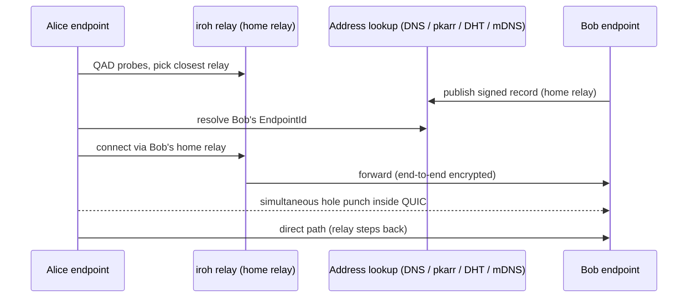

# Ideas bin

What `mic` considered and doesn't do, and how its decisions came about. Nothing here is
planned. It's kept so that the reasoning isn't lost, and so that an idea can be picked up again
with its context. `§` references point into [design.md](design.md) unless they say otherwise.

---

## 1. iroh

**Dropped.** No iroh dependency, no iroh key format, no iroh transport, no iroh follow-ups.
With relay only (D22) through moq.pro, iroh has nothing to do on the media path, and plain
Ed25519 keys (`ed25519-dalek`) cover identities. Self-hosters run `moq-relay` with a domain and
TLS certificate, like any other relay.

Former decisions: *D19, iroh-live is reference material for its MoQ media patterns only*;
*D26, iroh is not used at all*. The media patterns that `mic` keeps are in §5.7.

### 1.1 What it is

- A modular networking stack in Rust, with bindings for Swift, Kotlin, Python,
  JS, C, and Go.
- **Endpoint ID = Ed25519 public key.** That key is both the address and the
  TLS identity.
  - `mic` uses the same key format for its per-room identities (D16), so a
    per-room key could serve as an EndpointId if iroh returns as a transport.
  - `iroh_base::SecretKey::sign(&[u8]) -> Signature` exists, so the same key
    type can sign media (D18).
  - Persisting a `SecretKey` keeps a stable ID.
- Connections are full QUIC (noq) with **multipath**.

### 1.2 How a connection is made



- **Startup:** QAD (QUIC Address Discovery) probes on UDP 7842 learn the public
  address and pick the closest **home relay**.
- **Address lookup:**
  - DNS (`dns.iroh.link`, the default; self-hostable as `iroh-dns-server`),
  - the Mainline DHT,
  - or mDNS on the LAN.
- **Hole punching** happens inside QUIC.
  - It works in roughly 9 of 10 network setups.
  - It's deterministic: if it worked once between two devices, it keeps
    working on the same networks.
  - Otherwise traffic stays relayed.
- **The relay connection is HTTPS upgraded to WebSocket on TCP 443**, so calls
  still work, relayed, when UDP is blocked. (This was the planned D9 fallback
  before relay only, D22.)
- The relay is "always used, at minimum for the introduction". Disabling iroh
  relays "also removes hole punching" (moq.dev docs). Whether data can be
  kept off the relay entirely is the unknown behind "iroh relays for the
  introduction, if possible" (old question 8.7).

### 1.3 Relays

- Stateless; can't read traffic.
- **Public n0 relays:** free and rate-limited. **Dev only.**
- **Shared relays (n0 Pro):**
  - $19/month: four relays worldwide, up to 10,000 concurrent connections,
    100 GB relay egress per month (then $0.09/GB), a 5 MB/s rate limit, and
    API-key auth.
  - Only relayed traffic counts.
- **Dedicated relays:** managed and single-tenant.
- **Self-hosted `iroh-relay`:**
  - Needs TCP 80/443 (automatic Let's Encrypt) and UDP 7842.
  - Use `presets::Empty` plus a custom `RelayMap` to stop using n0's
    infrastructure.

### 1.4 Protocols, Router, tickets, gossip

- The **Router** dispatches incoming connections by **ALPN**; offering several
  ALPNs gives version negotiation.
- **Tickets** serialize dialing info into a shareable string.
- **`iroh-gossip`**: HyParView + PlumTree, 32-byte topic IDs, scales to a few
  thousand peers per topic, needs bootstrap peers.

### 1.5 Other iroh media work

- **`callme`**: P2P audio calls with `iroh-roq` (RTP over QUIC).
- The iroh docs point to **iroh-live** for live audio and video.

---
### 1.6 Using MoQ and iroh together

#### Why they fit

MoQ needs a QUIC-shaped connection. iroh provides one to any device,
addressed by key, with NAT traversal.

#### Integration points

| Where | What |
|---|---|
| `moq-net` + `web-transport-iroh` | Run a MoQ session over an iroh connection. |
| `moq-tokio` (`iroh` feature) | `iroh://<endpoint-id>/path` URLs. Its iroh accept/connect are `pub(crate)` and want to **own** the endpoint. An app that owns its own endpoint (for gossip etc.) should copy iroh-live's `iroh-moq` approach. |
| `moq-relay` | `[iroh] enabled = true` for a *self-hosted* relay. Not available on moq.pro as far as I can tell. |
| `iroh-moq` (in iroh-live) | Reference for ALPN negotiation, session dedup, and the protocol handler. |

**ALPN lesson:** register **all** of `moq_net::ALPNS` (newest first, HTTP/3
last), and offer the rest on dial.

#### iroh relay ≠ MoQ relay

- An **iroh relay** forwards opaque packets between two peers. It can't fan
  out.
- A **MoQ relay** terminates sessions, merges subscriptions, caches, and fans
  out.
- **moq.dev's advice:** keep iroh to the LAN and use a MoQ relay across the
  internet.
- **iroh-live:** P2P across the internet by default.

`mic` uses only a MoQ relay (D22, §5.1) and no iroh at all (D26). §2–3 are
kept as background research only.

---
### 1.7 iroh-live

Repo: <https://github.com/n0-computer/iroh-live>. MIT/Apache. An **early tech
preview**:

- rooms are being redesigned;
- its relay has no auth;
- Windows has never been run and iOS never built.

It's not on crates.io. It patches moq crates to a fork. Media is H.264-centric
(openh264 is vendored).

#### Crates

| Crate | Purpose |
|---|---|
| `iroh-live` | `Live`, `Call`, `Subscription`, tickets |
| `iroh-moq` | MoQ over iroh: node origin, sessions, ALPN |
| `iroh-rooms` | Gossip rooms (media-free); being redesigned |
| `moq-media` | Simulcast fan-out, adaptive switching, playout clock (no iroh dependency) |
| `iroh-live-cli` | The `irl` binary |
| `iroh-live-relay` | Browser bridge; out of scope |

#### Patterns worth copying

With relay only (D22), the P2P-specific patterns (per-peer `Call` paths, the
session accept/reject hook, gossip rooms) don't apply to `mic` v1. Tickets and
the media pipeline patterns (§4.3) still do.

- **Node-wide publishing.** A broadcast is announced on every session, so
  "also publish to a relay" is just one more connection.
- **`Call`** uses per-peer paths, `calls/<endpoint id>`.
- **Incoming sessions** expose `remote_id()` with `accept()`/`reject()`. That's
  the hook for allow-lists and kicks.
- **Tickets** carry the EndpointId only, no addresses. Their format has already
  broken compatibility once, so version `mic`'s invite format.
- **Rooms:**
  - A gossip topic plus a replicated KV of broadcast names and display names.
  - Chat on a `chat` track.
  - `PeerLeft` comes from media sessions closing.
  - A full mesh, "a small-group design".

#### Media pipeline patterns (kept in design §5.7)

- **Simulcast:** one capture, `Arc`-shared frames, **demand-gated encoders**
  per rendition.
- **Rendition switching:** the new decoder opens beside the old one, and frames
  go to the renderer through a **latest-wins slot**.
- **Receiver-driven adaptive bitrate** every 200 ms:
  - `delivery_bps` comes from moq-net's PROBE message.
  - Downgrade after 500 ms of bad conditions, upgrade after 4 s of good ones.
  - **BBR3 on every endpoint**, because CUBIC makes the estimate meaningless.
- **A/V sync:** a shared playout clock, with video held back by the speaker's
  buffered audio.
  - `realtime` mode holds 60 ms; `balanced` holds 100 ms.
  - Measured pipeline: 84 ms with no hold, 203 ms with the default policy.
- **Keyframe interval:** 1 s for calls.
- **Recording:** `irl record` writes encoded frames straight into fMP4/MKV with
  no decoding.

#### CLI (`irl`)

```sh
irl publish [--test-source] [--renditions low:320x180,720p]
irl watch <TICKET> [--latency realtime]
irl call | irl call <TICKET>
irl room --display-name alice [<TICKET>]
irl record <TICKET> -o clip.mp4
```

#### Local experiment: `irl call` (2026-10-24)

**Setup:**

- Built from a clone at `dd80d44` (tag `rolling-release`) in `target/spikes/`
  (gitignored).
- `cargo build --release -p iroh-live-cli` took **2m17s** on a 32-core Linux
  machine.
- The binary is **1.18 GB**, because the release profile keeps debug info.
  `target/` reached 7 GB.
- `nasm` was missing, so openh264 built without assembly.
- Ran two windowed `irl call --test-source --latency realtime` processes on the
  same machine (Wayland).

**Results:**

| Measure | Result |
|---|---|
| Connect time | About **200 ms** from dial to "call connected", both runs |
| Path | **Direct** (`relay=false` in all 343 trace samples). Info-level logs don't show direct vs relayed, contrary to the docs; it took `RUST_LOG=…,iroh_live::util=trace` to see it. |
| Codec | openh264 software, 1280×720@30, about **625 kbit/s** for the test pattern. Opus 48 kHz stereo. |
| CPU | About **26% of one core per process** at steady state |
| Memory | RSS 175–195 MB per process |
| Errors / panics | None |

**Observations:**

- Each process opened **three** openh264 encoders: one at startup and two on
  subscription. That's possibly duplicated work.
- When the peer is killed, the remaining side logs nothing at info level saying
  the call ended.
- The CLI and code are polished, and the MoQ track layout is clean:
  `catalog.json`, `video`, `0.opus`.

**Not tested:** NAT traversal and relay fallback between machines. With relay
only (D22), `mic` v1 doesn't need that test.

### 1.8 What iroh could have done for `mic`

With relay only via moq.pro, iroh isn't needed for media. Options considered:

| # | Use | What iroh adds | Caveats | Verdict |
|---|---|---|---|---|
| I1 | **Key format only** | Ed25519 keys compatible with EndpointIds | None; `ed25519-dalek` alone would do | **v1 baseline** |
| I2 | **Transport to a self-hosted `moq-relay`** (`[iroh] enabled = true`) | The relay is addressed by EndpointId: no domain or TLS certificate needed, and reachable behind NAT via iroh relays (e.g. a home server). "iroh relays for the introduction" (old 8.7) applies here. | Self-hosters only; moq.pro doesn't support it; browsers are relay-only | **Good fit for D8's self-hosted option.** Follow-up. |
| I3 | **Authenticated RPC to our own server** (`irpc`) | Mutual authentication by key in the QUIC handshake. The server is pinned by EndpointId (no certificate authorities); the device key is the credential (no bearer tokens). | The server must run iroh. Browsers would need relayed WASM iroh or a parallel HTTPS API. HTTPS with signed requests gets most of the benefit with standard tooling. | Optional |
| I4 | **Device linking** | A direct connection between a new and an existing device, started from a QR code or ticket, to enroll the new device (sign its key, copy settings) | Only matters with long-term identities | Good fit for options B or D (§5.15) |
| I5 | **Sync personal data across devices** (`iroh-docs`, a CRDT key-value store) | Contacts, settings and room history without a server | Scope creep; maturity under iroh 1.x unverified | Later, maybe |
| I6 | **Signed key-addressed records** (pkarr via iroh DNS or the DHT) | Publish a profile or device list under a public key without our server | n0's DNS is meant for address lookup; self-host `iroh-dns-server` or use the DHT; records are small | Possible for option B |
| I7 | **Direct 1:1 calls** as an egress saving | Lower latency and no relay egress for 1:1 | Reverses D22; a second code path | Not now |
| I8 | **Direct file transfer in chat** (`iroh-blobs`) | Large files without relay egress | Not requested | Later, maybe |

**Former recommendation (superseded by D26):** I1 in v1, I2 as the first
follow-up, I3/I4/I6 if identity went key-based.


---

## 2. Browser clients

**Not in v1 (D1).** Relay only makes a browser client technically feasible; the trade-offs
below are why it isn't planned.

**Correction to "without iroh, browsers become feasible":** iroh does run in
browsers (WASM), but "all connections from browsers … need to flow via a relay
server". What really makes browsers feasible is relay only (D22): the media
path is MoQ to a relay, which browsers can speak.

**What a browser client would use:**

| Piece | Browser option |
|---|---|
| Transport | WebTransport, or WebSocket as moq.dev's fallback. Both reach moq.pro. |
| E2EE | **`@moq/e2ee`** (TypeScript, on moq `main`, version 0.0.0, unreleased). An upstream quest plans encrypted `@moq/publish` / `@moq/watch` browser components. |
| Signatures, HKDF | WebCrypto: Ed25519, HKDF-SHA-256, AES-GCM. All of `mic`'s crypto would need to stay within what WebCrypto offers **(Ed25519 support per browser unverified)**. |
| Codecs | WebCodecs, with VP9/AV1 encode and decode in Chromium-based browsers and Firefox **(unverified per version)**. Safari stays out (D1). |
| Audio processing | The browser's built-in echo cancellation, noise suppression and AGC. D14 is about our own dependency tree, so this is fine. |
| UI | HTML (Leptos/WASM or TypeScript). Slint has a WASM target, but video integration there is unverified. |

**For:**

- Jitsi parity: "click a link, you're in", straight from the landing page.
- No install for guests.

**Against:**

- A second client to build and test, plus codec differences between browsers.
- **The web E2EE trust problem.**
  - Whoever controls the site (our GitHub repo or Pages) delivers fresh code
    on every page load, and could silently ship code that leaks the room
    secret.
  - Signed native releases are more auditable. Mitigations for the web are
    limited (e.g. installable apps, code-verification extensions).
  - That weakens D6 for browser users **(inference)**.

**Recommendation (inference):**

- Keep D1 for v1.
- Keep the door open by keeping the wire protocol browser-implementable:
  - Ed25519, HKDF-SHA-256, AES-GCM only;
  - nothing iroh-only;
  - JSON or simple binary formats.
- A smaller first browser step could be **watch-and-chat only**: join, view,
  listen, chat.


---

## 3. Dioxus Native

**Not used.** Slint is the UI (D20). This is the comparison behind that choice.

**Side by side:**

| | Slint 1.18.1 | Dioxus Native 0.8.0-alpha.3 / Blitz 0.3.0-beta.4 |
|---|---|---|
| Maturity | Stable 1.x (1.0 in 2023 **(unverified)**), company-backed | Alpha/beta. Blitz README: "usable … if you are an early adopter" |
| Programming model | Its own declarative `.slint` language, compiled to Rust; logic in Rust via properties, callbacks and models | React-like Rust components (RSX), HTML/CSS layout |
| Video tiles | `slint::Image::try_from(wgpu::Texture)` using Slint's own device (`unstable-wgpu-30`), or an underlay/overlay via `set_rendering_notifier` | A custom `Widget` that registers a `wgpu::Texture` (`wgpu_texture` example) |
| Redraw cost | Unknown on the wgpu path; must be measured | A report of 20–25 ms CPU per whole-window re-raster in Vello. That's a real risk with 30 fps video. |
| Stability | The wgpu interop module "may be removed or changed in future minor releases" | Panics and segfaults reported (#1197) |
| Widgets, text input | Mature widget set (line/text edit, list view, combo box) and several styles **(unverified list)** | HTML form controls; no `<select>` picker and no keyboard scrolling (per #1197) |
| Accessibility | AccessKit (winit backend); recent fixes in the changelog | AccessKit, listed in the Blitz README |
| Mobile (D2) | Android and iOS supported (1.18.1 fixed iOS rendering on Metal) | The Blitz browser ships Android builds; maturity for apps unclear **(unverified)** |
| Tooling | Language server with live preview | Dioxus CLI with hot reload |
| License | GPL-3.0, royalty-free with attribution, or commercial | MIT/Apache |
| Learning curve | A new DSL | Familiar to web developers |

**Dioxus Native / Blitz details:**

| Aspect | State (checked 2026-10-24) |
|---|---|
| Versions | `dioxus-native` **0.8.0-alpha.3** (2026-10-16), Blitz **0.3.0-beta.4**. The Blitz README calls it **beta**, "usable … if you are an early adopter". |
| Renderer | Default is `vello-hybrid`. `anyrender_vello` 0.15 depends on **wgpu ^30**, the same major as `moq-video`. |
| Custom GPU content | Supported. The `wgpu_texture` example implements `blitz_dom::Widget` and embeds it with `object { "data": CustomWidgetAttr::new(widget) }`. |
| `<video>` / `<audio>` | **Not supported**: "There is no media node in blitz-dom" (issue #1197). Tracking issue #259 is open. Not needed, since video tiles are custom widgets. |
| Known problems | From a downstream UI library's report (#1197, Oct 2026): panics when a form control is created and dropped in one render; a hit-test `unwrap` panic on removed text nodes; segfaults with `calc(%)` in fixed tables; no keyboard scrolling; no `<select>` picker. |
| Performance | The same report: "Every wheel step re-rasterises the whole window … Vello GPU spends 20-25 ms CPU". **Relevant:** video tiles need redraws at the video frame rate (`requires_redraw`), so whole-window re-rendering could cost a lot of CPU at 30 fps **(inference; measure it)**. |

How the `Widget` API works:

- It receives the renderer's wgpu `DeviceHandle` in `can_create_surfaces`.
- It registers a `wgpu::Texture` via
  `render_ctx.try_register_custom_resource(..)`.
- It returns `requires_redraw() -> true` for continuous animation.
- Its `paint` method fills a rectangle with the texture.

**Fit with `moq-video`:** `moq_video::render::Renderer::new(&device, &queue, …)`
accepts an external device. Create it from Blitz's `DeviceHandle` and register
each decoded frame's texture **(inference; this is the spike)**.

---

## 4. Video-codec strategies not taken

v1 uses VP9, with codecs negotiated per track so others can follow (§5.4). These were the
other strategies considered.

**The options:**

| # | Strategy | How it works | For | Against |
|---|---|---|---|---|
| A | **One codec: VP8** | libvpx both ways | Cheapest CPU, simplest, most robust | Worst compression; screenshare text suffers; dead end |
| B | **One codec: VP9** | libvpx both ways; decode already upstream | Cheaper software encode than AV1; one library; screen tuning exists | About 30% more bits than AV1; rare hardware encode; frozen codec |
| C | **One codec: AV1** | libaom RT (or SVT-AV1 `--rtc`) to encode, dav1d or rav1d to decode; hardware encode where present | Best compression and screenshare; hardware encode on many 2023+ PCs; where the industry is going | Heavier software encode on older laptops and every Mac; two libraries; needs a benchmark |
| D | **Per content type** | e.g. VP9 camera, AV1 screenshare. Jitsi's default is `screenshareCodec: 'AV1'`. | Screenshare (low fps, text) is where AV1 gains most, and it's cheap at low fps; camera stays cheap | Two codecs; bends D10 |
| E | **Decode everything, encode what fits** | Every client decodes VP9 and AV1. Each sender encodes AV1 if it has a hardware encoder or spare CPU, otherwise VP9. The choice is signaled in the catalog. | Uses hardware where it exists; degrades gracefully on weak machines | Biggest test matrix; behavior differs per sender |
| F | **Adapt at run time** | Like E, but switch codec or encoder speed at a keyframe under CPU pressure (Jitsi's `enableAdaptiveMode`; libwebrtc's libaom speed controller) | Robust under load | Complex; needs CPU-overuse detection |
| G | **Mixed simulcast** | e.g. AV1 low rung (small, so cheap in software) plus a VP9 or hardware-AV1 high rung | Fine-grained cost control | Complex for little gain |
| H | **Pure Rust later** | rav1e + rav1d | Memory safety when decoding other people's data | rav1e isn't tuned for real time; future option only. Pure-Rust VP9 (`rusty_vp9`, `vp9dec`) is too immature: `rusty_vp9` reports decode at ~0.16–0.21× FFmpeg's speed. |
| I | **Wait for AV2** | n/a | n/a | Spec only since May 2026; no real-time encoders, no hardware. Not viable for v1. |

---

## 5. Signing alternatives considered

Alternatives to the catalog-plus-checkpoint scheme (§5.3.2).

| Option | Verdict |
|---|---|
| **moq-secure's "lease"** (prior art named by the moq-e2ee draft): one signed frame authorizes the next `n_signed − 1` unsigned frames | Weak. The unsigned frames aren't cryptographically tied to anything, so an insider can inject inside the lease. Checkpoints cover the frames after the fact. |
| **Hold playback until the checkpoint arrives** | Adds up to 250 ms of latency to all media. Not worth it. |
| **Per-recipient MACs** (pairwise keys) | Deniable, and each tag is cheap. But a checkpoint needs O(N) tags plus pairwise key setup. Awkward at 40 people. |
| **TESLA-style delayed key disclosure** (RFC 4082) | Cheap MACs, but needs loose time sync and adds a disclosure delay. Over-engineered here. |
| **Transport authentication instead of signatures** | Moot: there's no P2P mode (D22). |

---

## 6. How the decisions came about

The research ran in revisions on 2026-10-24 and 2026-10-26.

Section numbers in this part refer to the research notes as they were then
(`docs/moq-iroh-research.md`), not to design.md.

- Revision 3 added a broad codec survey (§5.4), a review of the signing
  approach (§5.3), a Slint vs Dioxus Native comparison (§5.10), and a Jitsi
  Meet parity map (§5.14).
- Revision 4 folds in answers to the open questions: **relay only, no P2P
  mode**; per-room identities; Slint; `mic://` invites. §0.2 lists the
  knock-on effects and contradictions.
- Revision 5 adds an identity-system proposal (§5.15), the options for iroh
  (§5.16), and a fresh look at browser clients (§5.17). It also records a
  GitHub Pages domain with a landing page, the device-secret key derivation,
  and the 2 s grace deadline.
- Revision 6 (2026-10-26) drops iroh **completely** (D26): no dependency, no
  key format, no follow-ups. §2–§3 stay as background research only.

### Knock-on effects of revision 4 (with revision 5 status)

1. **iroh is no longer on the media path.** Revision 5 explores what iroh can
   still do (§5.16).
   - Relay only (D22) through moq.pro, which as far as we know doesn't accept
     iroh connections (§1.8). In v1, media and signaling go over `moq-tokio`
     (QUIC or WebSocket) to `cdn.moq.pro`.
   - iroh relays, address lookup, hole punching and gossip go unused. So does
     the n0 relay choice (old question 8.24).
   - What's left of iroh is the key format (D16), plus a possible future
     transport to a self-hosted `moq-relay`, which can speak iroh. The answer
     "iroh relays for the introduction" (old 8.7) only applies to that case.
   - This contradicts the earlier "iroh is a fixed part of the
     infrastructure".
   - **Resolved (rev 6):** iroh is dropped completely (D26), including the
     key format and the self-hosted-relay transport. Self-hosted relays use
     `moq-relay` over QUIC/WebSocket like moq.pro.
2. **Per-room identities simplify D18.**
   - A per-room key is short-lived and matters in one room only, so the
     session-key certificate (old D18 v2, step 1) is dropped. The per-room
     key signs directly.
   - This resolves P2 and the linkability half of P9 (§5.3.2). It also
     removes TOFU (§5.3.4).
   - Per-participant publish scoping in a future token service becomes cheap
     privacy-wise: the service only ever learns room-scoped keys.
3. **Rekeying without P2P needs public-key encryption.**
   - A kick (D5) needs a new room secret delivered only to the remaining
     members.
   - Before, that could go over pairwise iroh connections. Now it has to go
     through the relay, encrypted to each member's public key (HPKE-style),
     which is essentially what MLS does.
   - So the moderation and MLS follow-ups are linked.
4. **macOS is a release target (D23), but there was "no Mac experiment".**
   Macs always encode in software (no VP9/AV1 hardware encoder).
   **Resolved (rev 5):** build cross-platform and see, with no dedicated Mac
   experiment.
5. **Every call costs relay egress now**, 1:1 calls included. §5.8 has a
   rough budget against 400 GB/month.
6. **More metadata reaches the server.** The relay sees every participant's IP
   address, timing and packet sizes for every call. **Accepted (rev 5).**
7. **No domain.** **Resolved (rev 5):** a GitHub Pages domain hosts the
   version feed and keys. A token or identity service still needs compute
   elsewhere.
8. **No landing page.** **Resolved (rev 5):** invites are `https` links to
   the landing page, which opens `mic://` or offers downloads (§5.14).
9. **Questions that disappear:** room-mode switching (old 8.1), signing in P2P
   mode (old 8.4), the cross-machine NAT test (§6), the TOFU UX (old 8.18),
   and MLS commit ordering without a server.

### Decided in revision 4

Numbers refer to the revision 3 list.

| Old # | Question | Decision |
|---|---|---|
| 1, 4 | Room modes; signing in P2P mode | **Relay only, no P2P mode** (D22). Both questions disappear. |
| 3 | Signature details | **250 ms** checkpoints on a **separate `sig` track** (D18). Other details remain open (below). |
| 5 | MLS | v1 with a static room secret; MLS is a tracked follow-up (D17). |
| 6 | Identity linkability | **One identity per room** (D16). Downsides in §5.2. |
| 7 | Fallback opt-out | "iroh relays for the introduction, if possible". Moot: no iroh (D26). |
| 8, 9 | Decode set; mixing codecs | **VP9 + AV1 decoders in every client; mixed encoding is fine** (D10). |
| 10, 11 | Libraries | Chosen by testing during implementation; **dav1d leaning** for AV1 decode. |
| 12 | Upstream or in-house | **Leaning upstream** (`moq-video`). |
| 13 | Noise suppression | Chosen by testing during implementation (D14). |
| 14 | Slint spike | Approved. It stays in the repo and is excluded from the workspace afterwards (§5.10). |
| 15 | License | `mic` is **MIT + Apache-2.0** (D24), so Slint's royalty-free license with `AboutSlint` attribution. |
| 16 | Dioxus Native | Only if Slint proves unworkable (D20). |
| 17 | Recording consent | **Indicator only, like Teams** (D7). |
| 18 | Name collisions | **Fingerprint words** (leaning). TOFU is moot with per-room identities. |
| 19 | Platforms | **Windows, Linux, macOS** (D23). |
| 20 | Moderation | **Like Jitsi**, later (D5). |
| 21 | Invites | **`mic://`**; no landing page, no domain. *Superseded in rev 5: a GitHub Pages domain with a landing page (D25).* |
| 22 | Later features | **Background blur** first (D7). |
| 23 | Version feed | **Semver** (D15). Rev 5: `version.json` on our domain (§5.12). |
| 24 | iroh relays | "n0 for now", moot: no iroh (D26). |
| 25 | moq.pro allowance | Assume **400 GB/month**; enough for now (D8). |

### Decided in revision 5

- Per-room keys are **derived from a device secret** (§5.2).
- Checkpoint **grace deadline: 2 s** (§5.3.2).
- Relay metadata exposure is **accepted** (D6).
- **A domain on GitHub Pages**, built by GitHub Actions, with an invite
  landing page and `version.json` (D25, §5.12, §5.14).
- **No dedicated Mac experiment**, including for AV1 encoding: build
  cross-platform and see (D23).

### Decided in revision 6

- **No iroh at all** (D26): no dependency, no key format, no self-hosted
  relay transport, no follow-ups (§5.16).


### Former implementation sequence

Superseded by [PLAN.md](../PLAN.md).

**Suggested sequence (inference):**

1. **Spike: Slint video tiles.** 9 `moq-video` textures at 30 fps, measuring
   CPU and GPU per frame (§5.10). It stays in the repo (`spikes/video-tiles/`)
   and is explicitly excluded from the workspace afterwards.
2. **1:1 call through moq.pro**, covering:
   - a codec abstraction with the VP9 and AV1 decoders;
   - a first encoder;
   - Opus with AEC and noise suppression;
   - `moq-e2ee` and per-room signatures;
   - `https` invite links via the landing page, opening `mic://`;
   - the version check against `version.json`.
3. **Codec and audio testing during implementation:** encoders (libvpx, libaom,
   SVT-AV1); noise suppression (`nnnoiseless` vs `sonora-ns`); the AV1
   decoder (dav1d vs rav1d). Build cross-platform (D23), then upstream the
   codec work to `moq-video`.
4. **Rooms (up to 40):** roster under the room prefix, selective
   subscriptions, chat, reactions, raise hand, screenshare.
5. **Client-side recording** (WebM) with the indicator.
6. **Follow-ups (§8.4):** moderation (creator key first), MLS and rekeying;
   the identity/token server; background blur; hardware AV1 encode; adaptive codec switching; mobile;
   system audio; maybe a browser client.

---

## Sources

iroh:
- Home: <https://www.iroh.computer/>
- Docs index: <https://docs.iroh.computer/llms.txt>
- What is iroh: <https://docs.iroh.computer/what-is-iroh.md>
- Endpoints / relays / NAT traversal / protocols:
  - <https://docs.iroh.computer/concepts/endpoints.md>
  - <https://docs.iroh.computer/concepts/relays.md>
  - <https://docs.iroh.computer/concepts/nat-traversal.md>
  - <https://docs.iroh.computer/concepts/protocols.md>
- Network requirements: <https://docs.iroh.computer/configuring-networks.md>
- Shared relays: <https://docs.iroh.computer/iroh-services/relays/shared.md>
- Self-hosted relay: <https://docs.iroh.computer/iroh-services/relays/self-hosted.md>
- Gossip: <https://docs.iroh.computer/connecting/gossip.md>
- `SecretKey::sign`: <https://docs.rs/iroh-base/latest/iroh_base/struct.SecretKey.html>
- Blog, "What if your security camera was secure?": <https://iroh.computer/blog/secure-video-everywhere>
- callme: <https://github.com/n0-computer/callme>

iroh + MoQ:
- iroh-live: <https://github.com/n0-computer/iroh-live> (tested at `dd80d44`)
- Docs (`docs/` in repo):
  - `guide/index.md`, `guide/rooms.md`, `guide/tickets.md`, `cli.md`
  - `architecture/index.md`, `transport.md`, `publish.md`, `subscribe.md`, `adaptive.md`, `playout.md`, `p2p-relay.md`, `media-stack.md`

iroh (revision 5):
- WebAssembly and browsers (relay-only in browsers): <https://docs.iroh.computer/languages/wasm-browser.md>
- Security & privacy: <https://docs.iroh.computer/concepts/security-privacy.md>
- Documents (`iroh-docs`): <https://docs.iroh.computer/protocols/documents.md>
- RPC (`irpc`): <https://docs.iroh.computer/protocols/rpc.md>

Browser E2EE in moq (revision 5):
- `@moq/e2ee` (TypeScript): `js/e2ee/` in <https://github.com/moq-dev/moq>
- Encrypted browser components quest: `quest/m2/e2ee/browser.md`

UI:
- Dioxus: <https://github.com/DioxusLabs/dioxus>
- Blitz / Dioxus Native:
  - <https://github.com/DioxusLabs/blitz>
  - `wgpu_texture` example: <https://github.com/DioxusLabs/blitz/tree/main/examples/wgpu_texture>
  - Media tracking issue #259: <https://github.com/DioxusLabs/blitz/issues/259>
  - Downstream wishlist and bug report #1197: <https://github.com/DioxusLabs/blitz/issues/1197>
- Blitz README (status, AccessKit): <https://github.com/DioxusLabs/blitz/blob/main/README.md>
