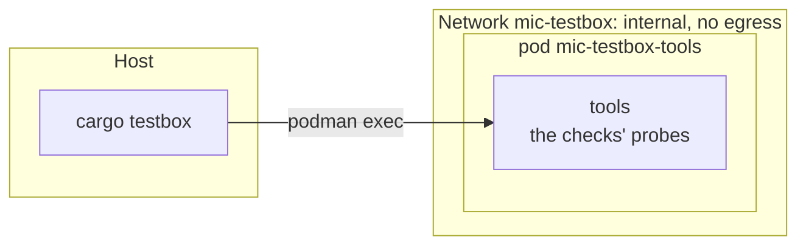

# testbox

Checks `mic` in a box of Podman pods on your machine, on an internal network: nothing in it
reaches anything outside. Every upstream is pinned (`xtask/src/pins.rs`), and images take network
only while they build. [PLAN.md](../PLAN.md) says what the box is growing into.

`cargo testbox --help` is the reference for the commands; `cargo testbox` is a Cargo alias
(`.cargo/config.toml`) of the `xtask` package.

## What is in the box



- **A pod per participant or service**, each from `testbox/pods/<pod>.yaml` under
  `podman kube play`. Containers of one pod share a network namespace, so shaping the network of
  one participant takes a pod of its own.
- **Images are tagged by what they're built from**: a hash of everything in `testbox/<image>/`
  and the pins the image takes. `up` builds only images whose tag is missing, so an unchanged
  box starts without a build. `cargo testbox images --prune` removes former states.
- **Every image is Arch Linux**, pinned by digest: its Mesa is close to the host's kernel driver,
  which the clients' GPU needs.

## What the host needs

- Linux with Podman, rootless: your user needs a subuid and subgid range (`/etc/subuid`,
  `/etc/subgid`). Netavark makes the internal bridge, so the kernel's `bridge` and `veth` modules
  must load.
- Network while the images build.
- Rust, as for `mic` itself.

## Running a phase

```sh
cargo testbox up
cargo testbox test box
```

Each check prints `check <what>: passed` or `failed: <why>`; `test` fails if any did. The last
check of every phase is that no container crashed. The phase's record, every container's log, is
in `target/testbox-record/<phase>/`. `cargo testbox down` stops the pods.

| Phase | What it checks |
|---|---|
| `box` | The network is internal; a pod resolves no outside name and opens no outside connection; an unchanged box starts without a build |
